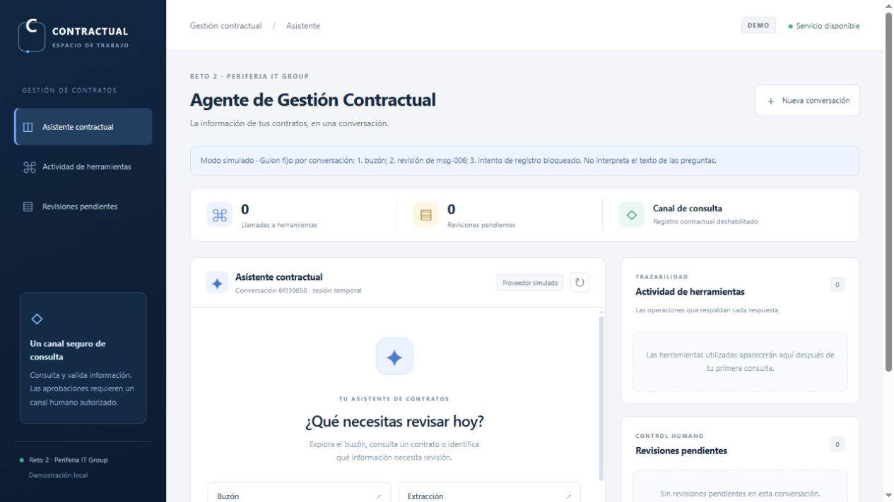

# Periferia — Reto 02

## Cómo ejecutar el proyecto localmente

La demostración se ejecuta **en el computador del evaluador**. Es necesario
descargar el código fuente e iniciar la aplicación localmente; por ahora no
se proporciona una URL pública de la aplicación. Los ejemplos siguientes usan
PowerShell en Windows y se ejecutan desde la raíz del proyecto.

### Paso 1. Requisitos previos

- Git instalado: comprobar con `git --version`.
- Bun **1.4.3**, versión verificada para este proyecto: comprobar con
  `bun --version`. Ver la [instalación oficial de Bun](https://bun.sh/docs/installation).
- Conexión a Internet para instalar dependencias y utilizar Gemini.
- Una API Key propia y válida de Google Gemini para el modo conversacional real.
- Un navegador web moderno.

No se necesitan IntelliJ IDEA, Node.js, n8n, una base de datos ni acceso real a
SharePoint o al correo corporativo. Para evaluar sin Gemini ni API Key, ver
[Modo de evaluación sin Gemini](#modo-de-evaluación-sin-gemini).

### Paso 2. Clonar el repositorio

```powershell
git clone https://github.com/jhcuadrosp/periferia-reto-02.git
cd periferia-reto-02
```

Esta URL corresponde al remoto Git configurado en el proyecto. Si el repositorio
es privado, el evaluador necesitará acceso concedido por su propietario.

### Paso 3. Instalar dependencias

```powershell
bun install
```

Instala las dependencias declaradas en `package.json`, incluidas las de desarrollo
necesarias para las pruebas. Se incluye `bun.lock` para reproducir sus versiones.
Para una instalación estrictamente ajustada al lockfile también se puede usar
`bun install --frozen-lockfile`.

### Paso 4. Configurar variables de entorno

Crear `.env` desde la plantilla **solo si todavía no existe**:

```powershell
if (!(Test-Path -LiteralPath .env)) {
  Copy-Item -LiteralPath .env.example -Destination .env
}
```

Editar `.env` con un editor de texto. La configuración principal actual es:

```dotenv
AGENT_PROVIDER=gemini
GEMINI_API_KEY=
GEMINI_MODEL=gemini-3.5-flash-lite
AGENT_MAX_ITERATIONS=10
AGENT_MAX_TOOL_CALLS=20
AGENT_MAX_TOKENS=60000
AGENT_PROVIDER_TIMEOUT_MS=15000
PORT=3000
HOST=127.0.0.1
PUBLIC_ORIGIN=
```

Completar `GEMINI_API_KEY` únicamente en el archivo `.env` local:

1. Abrir [Google AI Studio](https://aistudio.google.com/) con la cuenta propia.
2. Ir a **API Keys / Claves de API**, seleccionar o crear un proyecto y generar
   una clave habilitada para Gemini. Ver la [guía oficial de claves](https://ai.google.dev/gemini-api/docs/api-key).
3. Copiar esa clave al valor de `GEMINI_API_KEY` en `.env` y guardar el archivo.

Cada evaluador utiliza su propia credencial. La disponibilidad del modelo, cuotas
y posibles costos dependen de su proyecto de Google; no se garantiza consumo
gratuito ni acceso a un modelo para todas las cuentas. Consultar los
[límites de Gemini](https://ai.google.dev/gemini-api/docs/rate-limits).
`GEMINI_MODEL` corresponde a la configuración existente, y puede cambiarse por
un modelo Gemini disponible para la clave del evaluador.

Bun carga `.env` al iniciar. `.env.example` es una plantilla y no se carga como
configuración automáticamente. Las variables ya definidas en la terminal pueden
prevalecer sobre `.env`; después de cambiar valores hay que reiniciar el servidor.
La clave permanece en el backend: nunca debe copiarse al README, a la plantilla
ni a archivos versionados.

### Paso 5. Iniciar la aplicación

```powershell
bun run server
```

Mantener abierta la terminal y visitar **http://127.0.0.1:3000/** en el navegador.
Con los valores anteriores esa es la dirección configurada; si se cambia `PORT`,
utilizar la dirección impresa por el servidor. Bun entrega tanto la interfaz web
como los endpoints de la API, sin un segundo comando para el frontend.
Para detenerlo, pulsar Ctrl+C en su terminal.

### Paso 6. Probar el agente

Enviar desde el chat, por ejemplo:

- ¿Qué correos tenemos pendientes de procesar?
- Extrae la información contractual de Industrias Delta.
- Revisa msg-006 e indica qué información falta para registrarlo.
- ¿Qué contratos están próximos a vencer al 3 de septiembre de 2026?

En modo `gemini`, Google Gemini interpreta las consultas y el backend ejecuta
las herramientas deterministas. La interfaz muestra sus llamadas, resultados
y revisiones pendientes. Las sugerencias colocan texto en el campo; es necesario
pulsar **Enviar** o Enter para ejecutar la consulta.

**El registro contractual está deshabilitado desde el canal HTTP.** Las revisiones
humanas pueden visualizarse, pero no aprobarse desde el chat; escribir «confirmo»
no concede autorización. Para evaluar registros, actualizaciones e idempotencia
de forma determinista, ejecutar la demo del siguiente paso.

### Paso 7. Ejecutar las pruebas

En otra terminal, dentro de la carpeta del proyecto:

```powershell
bun run typecheck
bun test
bun run demo
```

| Comando | Qué evalúa |
|---|---|
| `bun run typecheck` | Comprueba los tipos de TypeScript sin generar archivos compilados. |
| `bun test` | Ejecuta las pruebas automáticas del dominio, herramientas, persistencia, agente, API y frontend con proveedores simulados. |
| `bun run demo` | Ejecuta los seis casos contractuales, registros y actualizaciones simulados, revisión, idempotencia y alertas, con fecha fija. |

**Las pruebas y `bun run demo` no consumen Gemini ni requieren API Key.**
La demo utiliza un directorio temporal aislado y conserva los fixtures originales
y el `out/` operativo. La aplicación conversacional y la demo determinista son
dos formas complementarias de evaluar el proyecto.

## Modo de evaluación sin Gemini

Después de `bun install`, no es necesario crear `.env`. En PowerShell:

```powershell
$env:AGENT_PROVIDER = "mock"
bun run server
```

También se puede definir `AGENT_PROVIDER=mock` en un `.env` propio y ejecutar
`bun run server`. No se requiere clave; abrir la misma dirección local.
La interfaz identifica explícitamente al proveedor simulado.

El mock **no es un modelo de inteligencia artificial ni genera respuestas con
Gemini**. Ejecuta un guion fijo por conversación, independientemente del texto:
primera consulta, buzón; segunda, revisión de msg-006; tercera, intento de registro
bloqueado. Las siguientes indican que terminó la simulación. **Nueva conversación**
reinicia el guion, sujeto a los límites de creación de sesiones.

Para volver a Gemini en esa terminal, detener el servidor y ejecutar
`$env:AGENT_PROVIDER = "gemini"`, teniendo la clave configurada en `.env`, y después
`bun run server`. Para la consola automática de demostración también existe
`bun run agente:mock`; no abre el frontend.

## Seguridad y archivos excluidos

Se incluyen los 14 archivos originales de `fixtures/reto-02/` necesarios para
evaluar los seis mensajes, el catálogo y el maestro. La aplicación trabaja con
copias temporales y no requiere un `out/` previo ni el archivo local `AGENTS.md`.

`.gitignore` excluye `.env` y variantes, secretos y certificados, `node_modules/`,
`out/`, compilaciones, cachés, logs, temporales y configuración local del IDE.
`.env.example`, `bun.lock`, código fuente, pruebas y fixtures deben versionarse.
No hay credenciales compartidas para la evaluación. Para revisar las exclusiones:

```powershell
git check-ignore -v -- .env out/log.jsonl node_modules/ .idea/workspace.xml
git ls-files -- fixtures/reto-02 .env.example
```

## Problemas frecuentes

| Problema | Solución |
|---|---|
| Bun no está instalado o no se reconoce | Seguir la instalación oficial, abrir una terminal nueva y ejecutar `bun --version`. Usar la versión verificada 1.4.3. |
| Faltan dependencias o aparecen módulos no encontrados | Ejecutar `bun install` desde la carpeta que contiene `package.json`. |
| No se configuró `GEMINI_API_KEY` | Crear `.env` desde la plantilla, completar la clave localmente y reiniciar. El arranque muestra un error controlado si falta configuración. |
| La clave es inválida o no tiene permisos | Revisar en AI Studio la clave y el proyecto habilitado para Gemini; actualizar `.env` y reiniciar. No imprimir ni publicar el valor para diagnosticarlo. |
| El modelo no está disponible | Comprobar `GEMINI_MODEL` y la disponibilidad para la cuenta. Con la configuración propia puede ejecutarse `bun run agente:real --verificar-modelo`: consulta los metadatos del modelo y no realiza inferencia. |
| Se alcanzó una cuota o el límite de solicitudes | Revisar cuotas del proyecto en AI Studio y esperar el restablecimiento correspondiente. Si es un límite HTTP local, esperar el plazo indicado; si es el presupuesto de tokens de la sesión, iniciar otra conversación. No hay reenvíos automáticos. |
| El puerto está ocupado | Detener el servidor anterior con Ctrl+C o ejecutar `$env:PORT = "3001"` y después `bun run server`; abrir `http://127.0.0.1:3001/`. |
| El frontend no llega al backend | Confirmar que el servidor sigue abierto, usar su URL y no abrir `web/index.html` directamente. No mezclar `localhost` con `127.0.0.1`. Probar en otra terminal `Invoke-RestMethod http://127.0.0.1:3000/api/health` ajustando el puerto. |
| Se mantiene otro proveedor/puerto tras editar `.env` | Revisar las variables de la terminal: pueden prevalecer sobre `.env`. Detener y reiniciar en una terminal nueva o actualizar la variable correspondiente. |
| La sesión caducó o se reinició el servidor | Pulsar **Nueva conversación**. Las sesiones permanecen en memoria del proceso y caducan. |

Para una evaluación exclusivamente local, mantener `HOST=127.0.0.1` y
`PUBLIC_ORIGIN=` vacío. No es necesario desactivar CORS, CSRF ni la protección
de cookies para que funcione.

## Demostración técnica

El evaluador puede comprobar la interacción conversacional con Gemini, las cinco
herramientas contractuales, extracción con confianza y evidencia, clasificación
y validación, revisiones humanas visibles, y trazabilidad/auditoría. Los paneles
solo muestran llamadas que realmente ocurrieron; no se garantiza que una consulta
particular haga invocar todas las herramientas. El registro propuesto por el
modelo se bloquea en HTTP; la demo prueba su ejecución determinista autorizada.

El terminal informa la ruta temporal de los reportes y la auditoría de cada
ejecución. `bun run demo` permite revisar los resultados contractuales sin LLM.
La documentación técnica detallada de las fases continúa a continuación.

**Esta entrega se evalúa localmente y todavía no dispone de una URL pública.**
Esta modalidad no sustituye el requisito de despliegue del PRD; ese entregable
permanece pendiente. No se ha desplegado ni publicado una aplicación en esta etapa.

La preparación se comprobó en una copia aislada de los archivos destinados al
repositorio, sin `.env`, `AGENTS.md`, `node_modules/` ni `out/` iniciales.
Después de `bun install --frozen-lockfile`, el chequeo de tipos pasó en 63
archivos, las 281 pruebas aprobaron y la demo completó 31/31 aserciones.
También se inició `bun run server` con mock y se verificaron la interfaz HTTP 200,
health y una consulta al buzón sin clave. No se consumió Gemini.

Para quien prepara la entrega: antes de compartir el enlace de GitHub, revisar
`git status --short` e incluir en el commit los archivos fuente nuevos, pruebas,
documentación y lockfile. Las modificaciones locales todavía no publicadas no
llegan al evaluador mediante `git clone`. Las exclusiones de `.gitignore` se
mantienen; no agregar `.env`, `AGENTS.md`, dependencias ni salidas operativas.

---

Proyecto TypeScript con Bun para construir progresivamente una solución de
registro de contratos. Incluye persistencia local y confirmación humana controlada
(Fase 5.2), herramientas deterministas y alertas (Fase 6.1), y demo integral
sin LLM (Fase 6.2), motor conversacional con proveedor simulado (Fase 7.1)
y adaptador Google Gemini con consola provisional (Fase 7.2).
Incluye estabilización del transporte por referencias y métricas (Fase 7.3).
El control adicional de revisiones distingue pasos omitidos de tareas terminadas.
La Fase 8.1A añade una [API HTTP con Bun](#fase-81a-api-http-con-bun), sesiones
protegidas y pruebas HTTP sin consumir el modelo.
La [Fase 8.1B](#fase-81b-frontend-web) incorpora el chat web con HTML, CSS y
TypeScript, servido por el mismo Bun. Todavía no se ha desplegado públicamente.

## Requisitos e instalación

- Bun 1.4.3, versión verificada en este proyecto.
- TypeScript 7.0.2 y tipos de Bun existentes.
- Zod como dependencia de ejecución para esquemas y validaciones.
- SDK oficial `@google/genai` 2.30.0 para Gemini; solo se utiliza al elegir el proveedor real.
- csv-parse para leer CSV con comillas, campos vacíos y delimitadores sin
  mantener un parser propio. Su API síncrona basta para los archivos pequeños
  del reto; no hace falta introducir streams ni procesamiento por lotes.

Desde esta carpeta, en PowerShell:

```powershell
bun install --frozen-lockfile
```

Si PowerShell no encuentra Bun, agrega su instalación al PATH de la sesión:

```powershell
$env:Path = "$env:USERPROFILE\.bun\bin;$env:Path"
```

## Comandos disponibles

```powershell
bun run index.ts
bun run typecheck
bun test
bun run diagnostico
bun run extraccion
bun run validacion
bun run registro
bun run revision
bun run herramientas
bun run demo
bun run agente:mock
bun run agente:real
bun run server
```

`bun run test` también ejecuta las pruebas. El chequeo de tipos usa `bun check`
y la configuración existente de `tsconfig.json`, sin emitir archivos compilados.

`bun run demo` ejecuta los seis casos dos veces en un proyecto temporal nuevo,
con reloj fijo y aserciones. No utiliza claves ni modifica el out/ operativo.

### Qué comando usar

| Comando | Qué comprueba | ¿LLM real / API Key? | Interacción |
|---|---|---|---|
| `bun run demo` | Los seis casos, reglas, persistencia, idempotencia y alertas mediante herramientas directas. | No / no. | Ejecución automática; no pasa por el motor conversacional. |
| `bun run agente:mock` | El ciclo del agente, herramientas y bloqueo de revisión con un proveedor simulado. | No / no. | Conversación automática de guion fijo; no recibe preguntas libres. |
| `bun run agente:real` | Interpretación de lenguaje natural, function calling y continuidad con Google Gemini. | Sí / sí. | Consola interactiva; escribir consultas y terminar con `salir` o `exit`. |
| `bun run server` | Chat web y API HTTP con sesiones protegidas. | Según `AGENT_PROVIDER`: `mock` o `gemini`. | Abrir `http://127.0.0.1:3000`. Registro contractual deshabilitado. |

Estos comandos utilizan proyectos temporales propios con copias de fixtures,
sin modificar los originales ni out/ operativo. Que demo o mock funcionen no
demuestra conexión con Gemini: esa comprobación requiere agente:real.
Los nombres de los comandos se escriben con **bun**, no con bum.

### Para qué sirven .env.example y .env

`.env.example` es una plantilla versionada para quien clone o ejecute el proyecto:
enumera las variables necesarias y sus valores de ejemplo, sin una clave real.
El programa no la carga automáticamente como configuración. Para usar Gemini,
se copia una vez a `.env` y se completa `GEMINI_API_KEY` localmente. Bun carga
`.env` al iniciar; config.ts valida las variables cuando arranca agente:real.
También pueden suministrarse directamente como variables del entorno del proceso.

`.env` contiene la configuración local y queda excluido de Git. No se debe
sobrescribir uno existente ni colocar credenciales en `.env.example`.
Después de cambiar los límites o la clave, reiniciar la consola para aplicarlos.

`bun run agente:mock` selecciona explícitamente `createMockProvider` desde
agente-mock.ts; no consulta `AGENT_PROVIDER` ni llama a loadGeminiConfig.
Por eso funciona sin crear `.env` y sin configurar una API Key, aunque la
plantilla diga `AGENT_PROVIDER=gemini`. Bun puede cargar un `.env` existente,
pero el mock no utiliza esas variables para conectarse a un proveedor.
Sus respuestas y solicitudes de herramientas están programadas; el motor,
las herramientas deterministas y la auditoría sí se ejecutan en la copia temporal.
El guion muestra saludo, consulta del buzón, revisión de msg-006 y bloqueo
del intento «confirmo». No genera tokens ni solicitudes a Gemini.

## Estructura inicial

- `index.ts`: ejemplo de ejecución TypeScript; no contiene lógica del reto.
- `src/domain/schemas.ts`: estructuras Zod del maestro, comerciales y correo.
- `src/domain/quality.ts`: diagnóstico, duplicados internos y advertencias.
- `src/domain/normalization.ts`: importes, monedas, fechas e identificadores.
- `src/domain/extraction.ts`: extracción pura a partir del contenido del TXT.
- `src/domain/validation.ts`: reglas RN1–RN5, enriquecimiento trazable y propuesta
  de operación en memoria.
- `src/domain/registration.ts`: prepara filas completas, IDs AUTO y rutas de archivo.
- `src/domain/review.ts`: presenta pendientes, valida correcciones y conserva su procedencia.
- `src/domain/confirmation.ts`: esquemas, hashes y comprobación de autorizaciones concretas.
- `src/domain/alerts.ts`: cálculo puro de vencimientos, pólizas, altas y representación Markdown.
- `src/storage/files.ts`: lectura de TXT y JSON con errores controlados.
- `src/storage/csv.ts`: lectura CSV mediante csv-parse; conserva campos como texto.
- `src/storage/mailbox.ts`: inventario de mensajes y comprobación de adjuntos.
- `src/storage/persistence.ts`: inicialización, evaluación y registro revalidado,
  idempotencia por mensaje y control de versión del maestro.
- `src/storage/audit.ts`: rutas dentro de out/, escrituras temporales, diario de
  recuperación y composición de eventos JSONL.
- `src/tools/contratos.ts`: cinco herramientas del PRD importables sin servidor ni modelo.
- `tests/setup.test.ts`: comprueba la ejecución del ejemplo y la disponibilidad
  de Zod con entradas válidas e inválidas.
- `tests/data.test.ts`: lectura real, entradas inválidas, errores y conservación
  de originales. Los archivos de prueba se crean fuera de fixtures.
- `tests/extraction.test.ts`: seis documentos, normalización, ambigüedades,
  evidencias, confianza, determinismo e integridad de los originales.
- `tests/validation.test.ts`: seis casos y límites sintéticos del motor de reglas.
- `tests/persistence.test.ts`: pruebas en proyectos temporales con copias de fixtures,
  reloj fijo, errores de escritura, recuperación, rutas e idempotencia.
- `tests/confirmation.test.ts`: revisión, decisiones explícitas, caducidad,
  integridad, consumo único y persistencia autorizada en copias temporales.
- `tests/alerts.test.ts`: fronteras de fechas, corte, pólizas y obligaciones del historial.
- `tests/tools.test.ts`: contratos de herramientas, errores, auditoría y autorizaciones en proyectos temporales.
- `diagnostico.ts`: presenta el diagnóstico completo como JSON en consola.
- `extraccion.ts`: muestra los resultados de extracción de los TXT del buzón.
- `validacion.ts`: evalúa el buzón contra el maestro y el catálogo originales.
- `registro.ts`: procesa el buzón contra el maestro de salida sin borrar resultados anteriores.
- `revision.ts`: demuestra revisión y autorización en un proyecto temporal aislado.
- `herramientas.ts`: muestra las cinco herramientas y genera un informe temporal sin tocar out/ operativo.
- `demo.ts`: verificación integral de los seis casos, segunda pasada y alertas.
- `tests/demo.test.ts`: ejecución CLI reproducible y detección de una discrepancia en datos de prueba.
- `agent/prompt.md`: comportamiento y restricciones del agente en español.
- `src/agent/provider.ts`: protocolo del proveedor y validación de respuestas.
- `src/agent/mock-provider.ts`: guion simulado independiente para cada sesión.
- `src/agent/session.ts`: historial, eventos, tickets y vínculos de revisión en memoria.
- `src/agent/tool-executor.ts`: lista permitida, contratos Zod y ejecución controlada.
- `src/agent/runner.ts`: ciclo conversacional, límites y coordinación de sesiones.
- `src/agent/human-review.ts`: comandos externos de revisión y decisión, separados del proveedor.
- `agente-mock.ts` y `tests/agent.test.ts`: muestra aislada y pruebas deterministas del motor.
- `src/agent/config.ts`: variables de entorno y límites validados con Zod.
- `src/agent/gemini-provider.ts`: solicitud al SDK, interpretación de respuestas y métricas seguras.
- `src/agent/gemini-history.ts`: roles, correspondencia de llamadas y conservación de partes del SDK.
- `src/agent/gemini-schema.ts`: declaraciones de las cinco herramientas desde sus esquemas existentes.
- `src/agent/tool-references.ts`: transporte compacto y recuperación de originales por referencia de sesión.
- `src/agent/context-window.ts`: cuatro turnos recientes completos para el contexto de Gemini.
- `src/agent/task.ts`: objetivo de revisión del turno, evidencia de validación y pendientes verificables.
- `src/agent/provider-error.ts`: errores públicos controlados, sin mensajes crudos de la API.
- `src/agent/tool-summary.ts`: presentación de hechos devueltos por herramientas, sin reglas nuevas.
- `agente-real.ts`: consola Gemini con almacenamiento temporal y métricas por turno.
- `tests/gemini-provider.test.ts`: API simulada y SDK con fetch sustituido; ninguna inferencia real.
- `tests/agent-optimization.test.ts`: referencias, cambios de fuentes, consultas finales, métricas y HITL sin LLM.
- `tests/task-completion.test.ts`: cierres prematuros, corrección acotada, objetivos por mensaje y estado incomplete.
- `.env.example`: configuración de ejemplo sin credenciales.
- `fixtures/reto-02/`: datos originales de solo lectura.
- `PRD.md`: requisitos originales, sin modificaciones.
- `out/`: resultados generados en ejecución y excluidos de Git.

Las carpetas vacías de `src/` incluyen `.gitkeep` para conservarlas en Git.
Solo `agente:real` requiere una clave local; las pruebas, demo y mock siguen sin necesitarla.

## Lectura y calidad de datos

El flujo es: archivo → lectura → validación Zod → registros válidos y problemas.
Este diagnóstico no escribe resultados en `out/` ni modifica los originales.
Las rutas de fixtures se resuelven desde la ubicación de `diagnostico.ts`,
independientemente del directorio desde el que se ejecute.

Cada problema incluye `archivo`, `campo`, `tipo`, `nivel` y `descripcion`:

- Un error de lectura, sintaxis o encabezado impide procesar ese archivo.
- Un error de estructura invalida solo el registro o los metadatos afectados;
  el diagnóstico continúa con los demás.
- Una advertencia informa duplicados o incoherencias sin descartar el registro.

El comando termina con código 1 si hay errores y con código 0 si no los hay.
Las advertencias no producen un código de error.

Las 16 columnas del maestro deben estar presentes. Todos los campos deben
tener un valor válido; `tipo_poliza` permite vacío cuando no se exige póliza.
No se convierte una celda vacía en cero, falso o null. Los importes aceptan
decimales con punto y sin separadores de miles. Como criterio de calidad,
se comprueba que sean finitos y no negativos. Los identificadores tributarios
se conservan como texto de dígitos, sin validar fiscalmente cada país.
El PRD no fija un patrón único para `id_contrato`: se exige texto no vacío,
sin imponer el prefijo CT- ni generar identificadores en esta fase.

El catálogo requiere `email`, `nombre` y `region`. Los correos requieren las
siete propiedades reales: `id`, `de`, `para`, `asunto`, `fecha`, `cuerpo` y
`adjuntos`. Un cuerpo vacío es advertencia; una lista de adjuntos vacía es
válida estructuralmente y no implica una clasificación contractual.

Los adjuntos TXT se leen solo para comprobar disponibilidad y contenido vacío;
el diagnóstico muestra su longitud, no extrae cláusulas ni campos del contrato.
Los demás formatos se comprueban como archivos legibles, sin interpretar su
contenido. Las rutas de adjuntos no pueden salir del directorio del mensaje.
No se comprueba la existencia de los PDF históricos del maestro, porque esos
documentos no forman parte de los fixtures entregados.

## Próxima etapa

La demo integral de Fase 6.2 se describe al final de este documento. La etapa siguiente requiere
aprobación y definición de alcance; no se avanza automáticamente.

## Extracción determinista (Fase 3)

`bun run extraccion` imprime JSON en consola, sin crear archivos en `out/`.
Reutiliza `readMailbox` y `readText`. La función `extractContract(text)` no lee
el maestro, el catálogo ni los correos: su única entrada es el texto documental.

El flujo es TXT → localizar encabezado y cláusulas → normalizar → validar
el resultado con Zod. No hay tablas de resultados por mensaje: un cambio de
ID, importe o fechas en el texto cambia la salida conforme a las mismas reglas.

La salida contiene:

- `tipo_documento`: contrato, otrosi, cotizacion o desconocido, según el
  encabezado. Describe la forma documental, no una operación de registro.
- `id_documento`: distingue el número de oferta o de otrosí del ID contractual.
- `campos`: las 16 propiedades del maestro, cada una con `extraido`,
  `normalizado`, `confianza` y `evidencia`.
- `valor_indeterminado`, `plazo_meses` y `condicion_poliza`: conservan datos
  adicionales que el CSV por sí solo no representa.
- `campos_modificados`: campos expresados en cláusulas modificatorias del
  otrosí. El ID es la referencia al contrato; los null de otros campos no
  son instrucciones para borrar ni reemplazar valores del maestro.
- `requiere_revision`: observaciones sobre campos documentales pendientes o
  de baja confianza; no decide registrar ni rechazar un documento.
- `advertencias`: problemas y limitaciones localizados por campo.

Los campos enriquecidos `comercial`, `estado_poliza`, `ruta_sharepoint`,
`fecha_registro` y `fuente` permanecen ausentes (extraído, normalizado y evidencia
null, confianza 0). No generan advertencias ni se incluyen en `requiere_revision`,
porque no se espera obtenerlos del TXT. Su resolución corresponde a etapas
posteriores, manteniendo la extracción documental original como evidencia:

| Campo enriquecido | Fuente futura |
|---|---|
| `comercial` | Remitente del correo y catálogo de comerciales. |
| `estado_poliza` | Maestro y reglas de negocio, nunca solo la cláusula de obligación. |
| `ruta_sharepoint` | Resultado del archivo del documento. |
| `fecha_registro` | Fecha efectiva de la operación de registro. |
| `fuente` | Canal de entrada comprobado por el proceso, como buzón o carga manual. |

La extracción no consulta estas fuentes. El motor de Fase 4 complementa los
campos que puede resolver con evidencia; ruta de archivo y fecha de registro
siguen reservadas para la ejecución futura.
Tampoco se genera un ID AUTO durante la extracción de un documento sin identificador.

### Reglas y decisiones

- El cliente se toma de la primera parte identificada, sin confundirlo con
  Periferia. El NIT pierde puntos y dígito de verificación; el RUC conserva
  sus dígitos. Son transformaciones sintácticas, no verificación fiscal.
- Solo se acepta un país mencionado explícita e inequívocamente en la primera
  parte, correspondiente al cliente. El nombre literal se conserva en `extraido`,
  su código en `normalizado` y el fragmento original en `evidencia`. No se usa el
  país del contratista para completar el del cliente, ni se infiere CO por NIT
  o por una ciudad. Sin evidencia suficiente, se conserva null con confianza 0.
  El extractor no aplica reglas de país inferido. El motor de validación puede
  complementarlo desde el maestro bajo el criterio documentado más adelante,
  sin modificar la extracción original.
- Solo se busca el importe contractual en la cláusula VALOR. En cotizaciones
  se usa el total estimado, no el importe mensual. No se toman porcentajes ni
  umbrales de las garantías como valor contractual.
- Se soportan importes numéricos como `265.000.000`, `120,000.00` y `1.234,56`.
  Un único separador con tres cifras finales (`1.234`) queda ambiguo. No se
  convierten importes escritos exclusivamente en letras ni se comprueba su
  equivalencia con la cifra. No se adivina la moneda a partir de `$`.
- Se reconocen fechas ISO y días en español con o sin cifra entre paréntesis.
  Se comprueba el calendario y la concordancia entre día escrito y numérico.
  No se derivan fechas por meses ni se usa la fecha del correo. El plazo
  explícito en meses se conserva separado.
- Sin cláusula de póliza, `requiere_poliza` queda null, no false. En msg-002
  y msg-004 hará falta evidencia adicional del correo, maestro o revisión.
  Una exención explícita sí permite false. Las condiciones por órdenes de
  servicio se conservan sin convertirlas en una obligación incondicional.
- En otrosíes se extraen el ID de referencia y los cambios explícitos de valor,
  moneda y fin. Se conserva la condición de ampliación de garantías sin
  modificar estados ni completar los demás campos desde el contrato base.
- En msg-006, `valor_indeterminado.normalizado = true` y `valor.normalizado = null`:
  el documento no contiene un monto fijo. Se conserva la cláusula original y
  el valor queda pendiente de revisión, con confianza 0.60. Un cero expresamente
  escrito en un documento sí se normaliza como 0; son situaciones distintas.
  El PRD 7.2 exige cero en el maestro para contratos por demanda: esa conversión
  se realizará mediante una futura regla de persistencia, validada y trazable,
  sin alterar el resultado de extracción. Su moneda queda null; el COP del umbral de
  póliza no demuestra la moneda de todas las órdenes. Agosto sin día de firma
  deja inicio y fin null. La prórroga automática queda en la evidencia del plazo.
- El objeto completo se conserva tanto en `extraido` como en `normalizado`, sin
  recorte ni pérdida de confianza por longitud. El esquema Zod de extracción
  permite ese texto completo. El esquema del maestro mantiene el máximo de
  200 caracteres del PRD 7.2: su adaptación requerirá una decisión posterior
  de validación o persistencia, sin sobrescribir ni perder el objeto original.

### Confianza

Son puntuaciones heurísticas explicables, no probabilidades calibradas:

| Puntuación | Criterio |
|---|---|
| 0 | Campo ausente: extraído, normalizado y evidencia null. |
| 0.98 | Dato explícito con interpretación inequívoca. |
| 0.65 | Importe explícito pero estimado en una cotización. |
| 0.60 | Valor expresamente indeterminado: normalizado null, con revisión. |
| 0.40 | Condición o formato no resuelto: conserva texto y normalizado null. |
| 0.30 | Fechas ligadas a una firma sin fecha exacta. |

Una cifra explícita puede estar bien leída sin ser un valor contractual
definitivo. Por eso se separan la representación original, la normalización y
la confianza. Los campos operativos no se incluyen en `requiere_revision`;
siguen visibles como null. En otrosíes solo se revisan la referencia y los
cambios extraídos; en cotizaciones los datos explícitos de la oferta.

### Límites

El extractor reconoce los encabezados, cláusulas y formatos documentados en
los fixtures. Otros diseños, monedas, importes en letras, cláusulas contradictorias
o múltiples condiciones requieren ampliar las reglas y sus pruebas. Se conservan
evidencias y advertencias; no constituye revisión jurídica ni un registro válido.

## Motor de reglas (Fase 4)

`bun run validacion` carga el maestro y catálogo con los lectores y diagnósticos
existentes, recorre los mensajes y llama a `validateContract(extraction, mail,
master, commercials)`. El motor es una función sin operaciones de archivos ni
servicios externos. Cada evaluación usa el maestro original: ninguna propuesta
se aplica al siguiente mensaje ni se escribe en disco.

### Orden y correspondencia con el PRD

1. **RN4 / HU-1:** sin adjunto contractual interpretable, cotización o texto no
   contractual se devuelve `rechazado`. Un contrato sin partes ni objeto
   identificables también se rechaza. La falta aislada de un campo esencial
   produce revisión, no rechazo automático. Los otrosíes pueden identificar
   partes y objeto a través del contrato base.
2. **RN1:** contrato ordinario con igual ID, valor y fechas inicial/final es
   `duplicado`. Datos propuestos null y diferencias vacías: no se modifica nada.
3. **RN2:** ID existente, o mismo NIT y objeto con similitud >= 0.9, identifica
   una posible actualización. Un otrosí explícito aplica RN2 antes de RN1.
   Se conserva la fila base en una copia y solo se superponen los campos
   modificados del otrosí; un cambio ilegible no reemplaza el original por null.
4. **RN3:** documento contractual sin coincidencia es `nuevo`, incluso si
   necesita revisión humana por información incompleta.
5. **RN5:** confianza menor que 0.8, falta esencial o contradicción bloquea la
   elegibilidad. Exactamente 0.8 cumple el umbral. La confirmación se incorpora
   separadamente en Fase 5.2; la clasificación por sí sola no autoriza.

RN1 y RN2 se solapan: RN1 no incluye moneda ni objeto. Se documenta esta
precedencia para no redefinir sus criterios. Una moneda contradictoria en un
duplicado se informa como revisión y no habilita ninguna modificación. Un
otrosí ya aplicado sigue siendo RN2 aunque no tenga diferencias; su idempotencia
por mensaje se resolverá con la persistencia futura.

El PRD no especifica la métrica de similitud. Se usa **Jaccard de conjuntos de
palabras**: intersección / unión, tras normalizar mayúsculas, acentos y signos.
El orden no afecta al resultado; no se interpreta semántica. Se exige NIT y
objeto con confianza >= 0.8 para usar esta coincidencia alternativa. Si el ID
documental difiere del encontrado por similitud, se conserva el ID del maestro
y se pide revisión. Varias coincidencias o un otrosí sin base localizada quedan
bloqueados como actualización pendiente, sin seleccionar una fila arbitraria.

### Enriquecimiento y procedencia

- **HU-3:** el correo del remitente se busca sin distinguir mayúsculas en el
  catálogo. En un nuevo contrato se propone el nombre resuelto. En una
  actualización se conserva el responsable original y se informa aparte el
  comercial remitente. Un remitente desconocido se advierte y no bloquea por
  sí solo; un catálogo con coincidencias múltiples sí requiere aclaración.
- **País, PRD 7.2:** si falta documentalmente, el NIT conocido y de confianza
  suficiente permite consultar los registros del mismo cliente. Solo se usa
  su país si es uniforme. Se marca origen maestro con IDs y NIT como evidencia;
  esto no es la regla eliminada NIT -> CO. Un país contradictorio requiere revisión.
- **Póliza, PRD 7.2:** una ausencia en el TXT puede completarse con una
  declaración explícita e incondicional del correo. No tener cláusula no
  significa false. Un correo no elimina una condición ambigua del documento;
  las contradicciones requieren revisión.
- En nuevos contratos con póliza se propone estado `pendiente`; sin póliza,
  tipo vacío y estado `no_aplica`. En otrosíes se conserva el estado del
  maestro y se advierte la ampliación de garantías exigida por el documento.
- El canal comprobado se propone como `fuente = buzon`. `ruta_sharepoint` y
  `fecha_registro` no se exigen al TXT y se dejan para la futura ejecución.
  El ID ausente también queda pendiente de generación AUTO (PRD 7.2), sin
  reservar secuencias durante una evaluación sin persistencia.

### Resultado y revisión humana

`validationSchema` comprueba mensaje e ID, operación, estado, elegibilidad,
campos de revisión, motivos, pendientes, propuesta, diferencias y evidencias.
Cada evidencia distingue documento, maestro, catálogo, correo, regla o pendiente,
con su puntuación heurística, respaldo y regla aplicada. No son probabilidades.
La extracción original y el objeto completo nunca se alteran.

`elegible_registro` significa **candidato según reglas**, no escritura ni
autorización ejecutada. Solo puede ser true para nuevo/actualización sin
revisiones. `estado_validacion` es `validado`, `pendiente_revision` o `no_aplica`.
Los campos operativos pendientes no se confunden con revisión humana.

| Mensaje | Operación | Elegible | Observación |
|---|---|---|---|
| msg-001 | nuevo | Sí | País complementado desde maestro; póliza pendiente. |
| msg-002 | nuevo | Sí | Correo declara que no pide póliza; no_aplica. |
| msg-003 | actualizacion | Sí | Valor 350000 -> 520000 PEN; fin 2027-05-01 -> 2027-11-01. |
| msg-004 | duplicado | No | Ninguna propuesta ni diferencia. |
| msg-005 | rechazado | No | Es una cotización. |
| msg-006 | nuevo | No | Revisión de valor, moneda, fechas, póliza y objeto. |

En msg-006 se preserva valor null y `valor_indeterminado = true`; la regla de
persistencia a cero sigue pendiente. Su objeto íntegro excede el límite de
200 caracteres del maestro, por lo que requiere adaptación revisada. El país
se complementa desde el mismo cliente existente. El remitente desconocido se
advierte, pero no es el motivo del bloqueo.

### Límites y evolución del registro

- `validacion.ts` sigue siendo un diagnóstico sin escrituras. `registro.ts`
  incorpora RN6, RN7, archivo, procesados e historial en Fase 5.1, como se detalla abajo.
- La escritura local revalida maestro, entradas y elegibilidad. Concurrencia
  multiproceso, almacenamiento remoto y durabilidad ante fallos físicos quedan fuera.
- La confirmación de Fase 5.2 está vinculada a los campos y valores revisados.
  No se ha autorizado ningún contrato mediante un booleano externo.
- El esquema final del maestro se comprueba antes de guardar. Para un remitente
  desconocido se conserva su email real como identificador provisional del
  comercial, con origen correo en auditoría y sin inventar un nombre (HU-3).
- Similitud, correlación por NIT y declaraciones del correo son reglas
  deterministas documentadas, no una validación jurídica ni de identidad fiscal.

## Persistencia contractual y trazabilidad (Fase 5.1)

```powershell
bun run registro
# Repetir el mismo comando demuestra idempotencia; no reinicia out/.
bun run registro
```

El primer procesamiento de los fixtures pasa de ocho a diez filas. Inserta
msg-001 y msg-002, actualiza msg-003, audita el duplicado msg-004 y el rechazo
msg-005 sin cambios contractuales, y deja msg-006 pendiente. En la segunda
ejecución los cinco primeros son `ya_procesado`; msg-006 permanece disponible
y se vuelve a auditar como pendiente, sin autorización automática.

### Inicialización y archivos

Se crea exclusivamente dentro del out/ de la raíz del proyecto:

```text
out/
  sharepoint/
    maestro-contratos.csv
    Contratos/
    historial.jsonl
  procesados.json
  log.jsonl
```

El maestro se copia de fixtures solo cuando no existe. Inicializar de nuevo no
reemplaza una copia con operaciones previas. Un maestro inválido o procesados
malformado bloquea el registro; no se repara ni reinicia silenciosamente.

Los nuevos documentos se archivan como
`Contratos/<año_inicio>/<cliente-slug>/<id_contrato>.txt`, con sus bytes originales.
Los otrosíes se conservan aparte como
`Contratos/<año_inicio>/<cliente-slug>/otrosies/<mensaje_id>/<id_contrato>.txt`.
Esta versión adicional evita reemplazar el contrato original: el maestro
conserva su ruta anterior y el historial guarda `ruta_archivo` del otrosí.
Los PDF históricos referenciados por el fixture no se inventan ni reconstruyen.
Un destino ya existente nunca se sobrescribe como documento.

Solo si se desea borrar los resultados de una demostración expresamente:

```powershell
bun run registro --reiniciar-demostracion
```

Ese comando elimina **todo out/** y vuelve a inicializarlo; no toca fixtures.
No se usa en el procesamiento normal. Las pruebas utilizan copias de fixtures
en directorios temporales aislados y reinicios explícitos dentro de esas copias.

### Flujo de registro y revalidación

1. `evaluateRegistration` lee el maestro de salida, correo, adjunto y catálogo.
   Ejecuta las reglas y devuelve un ticket con la validación y hashes SHA-256
   del maestro y de las entradas. No reserva IDs ni escribe contratos.
2. `persistRegistration` relee las fuentes y recalcula la validación. Rechaza
   tickets alterados, campos extra como `confirmado`, entradas modificadas y
   cualquier cambio del maestro desde la evaluación. El hash cubre todo el
   CSV, no solo la fila a actualizar. Se debe volver a evaluar tras un cambio.
3. La fila final se prepara únicamente si sigue elegible. Se generan ID AUTO
   cuando falta, fecha de registro y ruta de archivo. El ID AUTO toma el año
   inicial y la siguiente secuencia existente bajo la serialización local.
   La fecha usa el reloj de la operación y zona America/Cancun; en pruebas el
   reloj está fijado. Se valida nuevamente con el esquema Zod completo del maestro.
4. En actualizaciones se aplican solo las diferencias revalidadas y se
   conservan literalmente los demás campos CSV. Se vuelve a comprobar la base.
   No se cambia comercial, ruta original, fuente ni fecha original de registro.
5. Se prepara el conjunto de archivos, se comprueba de nuevo la versión del
   maestro antes de cada reemplazo y se aplica la escritura recuperable.

Si un remitente no está en el catálogo pero el contrato está completo, se
conserva su email como identificador verificable en `comercial`. El historial
indica `comercial_catalogado: false`, origen correo y evidencia del remitente;
no se presenta ese identificador como nombre resuelto. Msg-006 sigue bloqueado
por sus otros campos pendientes. No se convierte valor indeterminado a cero,
no se resume el objeto ni se implementa confirmación humana en esta fase.

### Auditoría, historial y obligaciones

- `historial.jsonl` contiene únicamente altas y actualizaciones efectivas:
  `{ ts, id_contrato, accion, cambios, mensaje_id }`, más ruta archivada,
  evidencias, derivados y advertencias. El otrosí original tiene dos diferencias.
- `log.jsonl` conserva cada intento de procesamiento, incluidos errores,
  duplicados, rechazos, pendientes y reintentos. Mantiene el formato RN7:
  `{ ts, herramienta, mensaje_id, ok, resumen }`, con validación detallada,
  hashes de fuentes, resultado y obligaciones. `herramienta` es `registro_local`
  porque aún no se han creado herramientas del agente.
- La exención de msg-002 conserva explícitamente origen `correo` y el texto
  que dice que no pide póliza, tanto en log como en historial del alta.
- Los conflictos de moneda, identidad o póliza en duplicados conservan RN1,
  advertencia `CONFLICTO_DUPLICADO`, valores enfrentados y revisión. No hay
  cambios contractuales ni archivado; si hay revisión, el mensaje no se marca
  terminado y sigue disponible.
- El otrosí conserva el estado histórico `vigente`. En ambos registros se
  almacena `obligaciones_pendientes` con `AMPLIAR_GARANTIAS`: vigente no prueba
  que la ampliación haya sido realizada. No se crea un estado de póliza nuevo.
- `procesados.json` contiene solo mensajes terminados, con hash de entrada,
  clasificación, ID y timestamp. Los pendientes permanecen fuera; sus motivos
  y evidencias quedan en log y el documento sigue en el buzón original.

Un mensaje terminado no se repite, aunque el ticket original tenga un hash
anterior del maestro. Si el contenido de un mensaje ya procesado cambia, se
bloquea para revisión. Un contrato reenviado bajo otro mensaje se detecta por
las reglas; un otrosí cuyo cambio ya está aplicado se audita como `sin_cambios`,
conservando RN2 pero sin nuevo historial ni archivo contractual.

### Fallos, rutas y alcance transaccional

Las escrituras usan temporal y rename dentro del mismo directorio. Antes del
conjunto de reemplazos se crea `out/.transaccion.json`, un diario pequeño con
imágenes anteriores y propuestas. Un error controlado revierte los archivos.
Después de una interrupción, la siguiente inicialización revierte un diario
preparado o termina la limpieza de uno confirmado. `confirmado` en ese diario
significa commit de archivos, nunca confirmación humana de datos.

Si aparecen cambios externos que no coinciden con ninguna imagen, se bloquea
la recuperación y se conserva el diario para revisión, sin sobrescribir esos
cambios. Si tampoco puede escribirse el log de error, la respuesta lo informa.
Los JSONL previos se comprueban antes de incorporar otra línea, y no se
concatenan sobre contenido JSON malformado.

Todas las rutas de escritura y recuperación deben permanecer dentro de out/.
Se rechazan rutas absolutas, ascensos, nombres inseguros y enlaces simbólicos
o junctions en su recorrido. El reinicio valida el destino antes de borrar.

La cola en memoria serializa operaciones del mismo proyecto **en un proceso**.
El diario ofrece recuperación local, no una transacción de base de datos:
no hay bloqueo distribuido ni garantías ante dos procesos, modificaciones
externas maliciosas concurrentes o pérdida física de almacenamiento. No se
debe ejecutar más de un escritor sobre el mismo out/. Para producción se
necesitarán bloqueo y almacenamiento transaccional apropiados.

## Confirmación humana controlada (Fase 5.2)

```powershell
bun run typecheck
bun test
bun run revision
```

La demostración copia los fixtures a un directorio temporal y muestra su ruta.
No utiliza ni modifica el out/ operativo. Primero presenta msg-006, sus campos
y motivos; sin aclaraciones completas continúa bloqueado. Después crea un
mensaje sintético independiente, con importe y moneda ausentes, y demuestra
la corrección explícita a 1500 USD, aprobación y registro. Estos datos ficticios
no se atribuyen al contrato CM-2026-03. El reloj de esa demostración está fijado
en 2030 y el maestro temporal pasa de ocho a nueve filas.

### Flujo y responsabilidades

1. `evaluateRegistration` genera el ticket existente. `inspectReview` presenta
   extracción original, propuesta enriquecida, valores actuales, evidencias,
   advertencias y motivos. Un comercial desconocido aparece como observación
   no bloqueante, conforme a HU-3.
2. `createConfirmation` recibe ticket, correcciones y revisor. Solo permite
   nuevos o actualizaciones pendientes; no habilita duplicados ni rechazos.
   Cada corrección contiene campo, valor propuesto, justificación y procedencia.
   Se añaden valor anterior, revisor y fecha, se comprueba con Zod y se ejecuta
   nuevamente `validateContract` sobre una copia. El original permanece íntegro.
3. Si quedan pendientes, se auditan las correcciones válidas y se informa
   revisión incompleta, sin generar autorización. Un nuevo intento debe enviar
   el conjunto completo de correcciones: no se acumulan cambios implícitos.
4. Con propuesta válida se genera `out/confirmaciones/<UUID>.json`. Incluye
   mensaje, contrato, operación, hashes del maestro y entradas, extracción y
   validaciones, correcciones, revisor y las 16 columnas concretas del registro.
   `datos_hash` vincula los valores finales y `contenido_hash` toda la revisión.
   La solicitud nace pendiente, sin modificar el maestro.
5. `decideConfirmation` exige `{ solicitud_id, datos_hash, accion }`, con acción
   `aprobar` o `rechazar`, más el contexto del revisor. Registra decisión y fecha.
   Aprobar no escribe el contrato. Una decisión no se cambia ni reutiliza.
6. `persistConfirmedRegistration` recibe `{ solicitud_id, datos_hash }` y el
   revisor. Relee la solicitud aprobada, revalida fuentes, maestro, reglas y
   correcciones, y compara la fila final con los valores autorizados. Rechaza
   mensajes ya procesados y operaciones equivalentes. Reutiliza la transacción
   de Fase 5.1: archivo, maestro, historial, procesados, log y solicitud utilizada
   se aplican juntos. Un fallo controlado revierte el conjunto y deja la
   solicitud aprobada disponible para reintentar si sigue vigente.

Estados: `pendiente → aprobada → utilizada`, o `pendiente → rechazada`.
La vigencia por defecto es de 30 minutos, configurable entre 1 y 60. Se comprueba
antes de cada reemplazo; una caducidad durante la escritura provoca reversión.
Si la fecha local del registro cambia entre revisión y ejecución, se exige nueva
revisión para no almacenar una fecha distinta de la autorizada. También se
bloquea cualquier cambio del maestro, documento, correo o catálogo relevante.
La ruta normal `persistRegistration` conserva sus comprobaciones y no acepta
una validación editada ni un argumento externo `confirmado=true` como autorización.

### Tratamientos pendientes de msg-006

- **Valor:** sigue siendo null e indeterminado en la extracción original. Una
  corrección `tratamiento_valor = indeterminado_como_cero` permite preparar cero
  para el maestro, conforme al PRD 7.2. Se persiste exclusivamente después de
  aprobar la solicitud completa; el historial aclara que no es un importe real.
  No se permite reemplazar ese valor por un importe fijo inventado.
- **Moneda y fechas:** requieren aclaraciones expresas y fechas exactas válidas;
  no se infieren del umbral de póliza ni de una firma sin día conocido.
- **Póliza:** resolver una condición requiere tanto `requiere_poliza` como
  `tratamiento_poliza = condicion_activada` o `condicion_no_activada`, coherentes
  y con fundamento documentado. No basta la ausencia de póliza. La condición
  original se conserva para auditoría. Los otrosíes mantienen el estado histórico
  de póliza y las obligaciones de ampliación pendientes.
- **Objeto:** se admite una adaptación humana de hasta 200 caracteres; el texto
  contractual completo continúa en la extracción, solicitud y archivo original.
- **Comercial:** puede aclararse con nombre y procedencia humana. Si sigue sin
  resolver, se conserva el criterio de Fase 5.1: email del remitente con origen
  correo, sin inventar un nombre y sin bloquear únicamente por ese motivo.

Las correcciones solo afectan campos pendientes o ausentes, nunca rutas,
fechas de registro, fuente o estado histórico. La revalidación no concede una
excepción general a conflictos semánticos: si una regla sigue detectando un
conflicto, el registro permanece bloqueado. La puntuación 1 en una corrección
identifica una declaración humana explícita; no es una probabilidad calibrada.

### Auditoría y límites

`out/log.jsonl` conserva revisión incompleta, creación de solicitud, aprobación
o rechazo, intentos y errores. La solicitud conserva las correcciones con
anterior/propuesto, justificación, procedencia, actor y fecha. Solo una operación
realmente aplicada añade `revision_humana` al historial contractual: solicitud,
hash autorizado, decisión, correcciones, condición original y tratamiento del
valor. La exención proveniente del correo conserva su procedencia existente.

El revisor usa `{ id, modo: "simulado_local" }` como contexto separado de los
argumentos de decisión. Esto no equivale a autenticación real. Los hashes detectan
cambios dentro de este flujo, no son firmas ni protegen de una persona con
control completo de los archivos y el código. Se conserva la limitación de un
solo proceso escritor de Fase 5.1. No se añaden dependencias, servicios externos,
LLM, frontend, herramientas del agente, alertas ni `demo.ts` en esta etapa.

## Herramientas deterministas y alertas (Fase 6.1)

`src/tools/contratos.ts` exporta exactamente los cinco objetos obligatorios.
Cada objeto tiene `description`, `args` (campos Zod con descripción) y
`execute(args, ctx): Promise<string>`. El nombre público se forma como indica
el PRD: archivo `contratos` + nombre exportado. No se necesita servidor.

| Nombre público / export | Argumentos y Zod | Resultado y responsabilidad | Reutilización / reglas |
|---|---|---|---|
| `contratos_leer_buzon` / `leer_buzon` | `{}` estricto | `{ mensajes[] }`, excluye procesados, incluye `tiene_contrato`, clasificación y problemas por mensaje | `readMailbox`, `evaluateRegistration`, procesados; HU-1, RN4 |
| `contratos_extraer` / `extraer` | `{ mensaje_id }`, ID seguro | Extracción original con confianza y evidencia; cotización sigue identificada como tal | `inspectMessageInput`, `extractContract`; HU-2 |
| `contratos_validar` / `validar` | `{ mensaje_id, contrato }`, `extractionSchema` | Clasificación, diferencias, revisión y `contrato` como ticket íntegro para registrar | `evaluateRegistration`, `validateContract`; RN1–RN5 |
| `contratos_registrar` / `registrar` | `{ mensaje_id, contrato, confirmado? }`, `registrationTicketSchema` y booleano opcional | Acción realmente aplicada, pendiente o sin escritura contractual | `persistRegistration`, `persistConfirmedRegistration`; RN1–RN7 y Fase 5.2 |
| `contratos_alertas` / `alertas` | `{ hoy }`, `dateSchema` | `{ ruta, vencen, vencidos, polizas_pendientes, registrados_desde_corte, obligaciones_pendientes, ... }` y `out/alertas.md` | Maestro de salida e historial; HU-5 |

Los lectores, la extracción, RN1–RN5 y la persistencia no se reimplementan en
las herramientas. Los nuevos adaptadores de `persistence.ts` comparten su cola
local, recuperación y comprobaciones: consultar una instantánea, leer entradas,
auditar llamadas y escribir el informe. La inicialización de out/ sigue RN6;
las llamadas de lectura también generan auditoría, pero no registran contratos.

### Entradas y salidas

El nombre `contrato` de la firma del PRD representa dos estados sucesivos:
en `validar` recibe la extracción de `extraer`; en `registrar` recibe el ticket
devuelto por `validar`. El ticket conserva versión del maestro, hash de entradas
y validación, para detectar cambios entre ambas llamadas. No se permite enviar
una propuesta libre directamente a persistencia. Los argumentos de nivel
superior son estrictos; las correcciones siguen el flujo humano de Fase 5.2.

```ts
import { extraer, validar, registrar, alertas } from "./src/tools/contratos.ts";

const ctx = { directory: raizDelProyecto, sessionId: "sesion-local" };
const extraido = JSON.parse(await extraer.execute({ mensaje_id: "msg-001" }, ctx));
if (!extraido.ok) throw new Error(extraido.error);
const evaluado = JSON.parse(await validar.execute({ mensaje_id: "msg-001", contrato: extraido.data }, ctx));
if (!evaluado.ok) throw new Error(evaluado.error);
const resultado = await registrar.execute({ mensaje_id: "msg-001", contrato: evaluado.data.contrato }, ctx);
const informe = await alertas.execute({ hoy: "2026-09-03" }, ctx);
```

Ejemplos de respuestas resumidas (la salida real incluye más campos):

```json
{"ok":true,"data":{"accion":"registrado","estado":"aplicado","id_contrato":"CT-2026-015"}}
{"ok":true,"data":{"accion":"pendiente_revision","estado":"requiere_revision","aplicado":false,"requiere_revision":["valor","moneda","fecha_inicio","fecha_fin","requiere_poliza","objeto"]}}
{"ok":false,"error":"confirmado=true no concede autorización humana; falta solicitud aprobada."}
```

Un pendiente es una evaluación completada sin escritura contractual. Los
duplicados, rechazos y reintentos terminados se distinguen con su acción y
estado `sin_escritura_contractual`; no se anuncian como altas nuevas.
Los argumentos inválidos, archivos ilegibles y autorizaciones inválidas devuelven
`ok:false`. `execute` captura errores para que el consumidor pueda continuar.

### Autorización y auditoría

Se conserva `confirmado?: boolean` en la firma obligatoria. Para true, el
consumidor local debe proporcionar además `ctx.autorizacion = { solicitud_id,
datos_hash, revisor }`, obtenida mediante revisión y decisión explícita de Fase 5.2.
Ese contexto no forma parte de los argumentos de la herramienta y no debe ser
controlado por un futuro modelo. Las herramientas no crean ni aprueban solicitudes.
La identidad sigue simulada y no equivale a autenticación.

Antes de ejecutar se compara el ticket con la solicitud almacenada; persistencia
revalida fuentes, maestro, correcciones, elegibilidad, datos finales, caducidad
y consumo único. Un true aislado, una elegibilidad editada, un hash distinto o
una solicitud reutilizada no autorizan. Para datos originalmente completos se
mantiene el registro normal sin confirmación, conforme a HU-4.

Todas las llamadas dejan RN7 en log.jsonl con nombre público, mensaje, sesión,
resultado y timestamp. La auditoría detallada del registro y de la autorización
se conserva además mediante los módulos existentes. Si no se puede escribir
el log, la respuesta añade `error_auditoria`. Una escritura contractual ya
aplicada no se presenta como fallida por un error posterior al auditar la llamada.
Un contexto inválido puede impedir disponer de un destino confiable de auditoría;
se informa ese fallo expresamente, sin escribir en otra ruta.

### Reglas exactas de alertas

- `hoy` es obligatorio. Los cálculos usan días de calendario UTC, sin consultar
  el reloj actual. Vence hoy corresponde a 0 días; próximos son 0–60 inclusive.
  Los negativos aparecen separados en `vencidos`, sin mezclarse con los próximos.
- Póliza pendiente significa `requiere_poliza=true` y `estado_poliza!=vigente`:
  incluye pendiente, vencida y una posible incoherencia no_aplica. Se muestra el
  estado recibido, sin crear estados ni deducir expiraciones de póliza desde
  la fecha final contractual; el maestro no contiene su fecha de vencimiento.
- El corte del PRD es inclusivo: `fecha_registro >= 2026-05-30`. El reporte es
  a la fecha `hoy`, así que registros con fecha posterior se advierten y no se
  cuentan todavía como gap cubierto. Un otrosí conserva la fecha original y no
  se cuenta como alta nueva solo por tener historial reciente.
- Las obligaciones `AMPLIAR_GARANTIAS` se recuperan de operaciones aplicadas en
  historial, sin nombres de contratos codificados en la regla. Así se mantiene
  visible la de CT-2026-011 aunque su estado histórico sea vigente. No existe
  todavía una operación para certificar su cumplimiento: la alerta conserva
  expresamente el carácter pendiente según la evidencia disponible.
- El Markdown contiene las tres secciones de HU-5, con subsecciones para
  vencidos y ampliaciones. Las tablas ordenan los resultados y conservan las
  evidencias; el maestro no se modifica. Una nueva generación reemplaza solo
  `out/alertas.md` mediante escritura recuperable, comprobando la versión del
  maestro y del historial. Datos inválidos bloquean el informe sin borrar uno previo.

### Muestra local y siguiente fase

```powershell
bun run herramientas
```

El comando crea un proyecto temporal con copia de fixtures, lista el buzón,
aplica únicamente el otrosí msg-003, demuestra el bloqueo de msg-006 y genera
alertas para 2026-09-03. Imprime la ruta absoluta del informe. No borra ni cambia
el out/ operativo. El resultado esperado es dos contratos próximos a vencer,
dos vencidos, una póliza obligatoria no vigente, ninguna alta desde el corte y
la ampliación pendiente de CT-2026-011.

Las pruebas usan copias temporales y cubren las cinco herramientas, argumentos,
errores, JSON, idempotencia, revisión, autorizaciones inválidas y reutilizadas,
límites 0/60/61 días, bisiestos, integridad y reporte repetible.

Las pruebas de herramientas, confirmación y persistencia disponen de 30 segundos
por caso mediante `tests/helpers/integration.ts`, por sus operaciones reales de
archivos. La limpieza espera a que termine el
cuerpo, incluso si Bun lo declaró agotado: el timeout no cancela sus promesas.
Así no se borran temporales mientras una transacción sigue escribiendo o
recuperándose. Una operación que supera el límite continúa siendo una prueba
fallida; no se silencian los errores de persistencia. El hook de limpieza tiene
un límite independiente de 60 segundos.

Límites: sigue siendo almacenamiento local con un proceso escritor; no hay
autenticación real, LLM ni frontend. Solo se interpretan adjuntos TXT. Varios
TXT requieren aclaración; no se elige uno arbitrariamente. Los mensajes con
errores se reportan por separado y no detienen el inventario completo.
Las alertas son un informe, no notificaciones enviadas a terceros.

La Fase 6.2 utiliza estas mismas herramientas mediante `demo.ts`, como se
detalla a continuación. No se incorpora todavía el ciclo conversacional.

## Demo integral determinista (Fase 6.2)

```powershell
bun run typecheck
bun test
bun run demo
```

El script llama directamente a los cinco métodos `execute`. Comprueba con Zod
los sobres JSON y los resultados; un error de herramienta o de auditoría queda
como fallo y no se presenta como éxito. Los errores de un mensaje no impiden
intentar los restantes. Las reglas de extracción, clasificación, registro y
alertas continúan en sus módulos existentes. Los IDs de los fixtures solo se
usan para comprobar expectativas, nunca para decidir las reglas aplicadas.

Cada invocación crea `periferia-demo-<sufijo>` dentro del directorio temporal
del sistema y copia allí fixtures. `leer_buzon` inicializa el maestro de ocho
filas según RN6. El reloj de las herramientas es `2026-09-03T12:00:00.000Z`;
la referencia de alertas es `2026-09-03`. No se utiliza el reloj real para decidir
registros ni vencimientos. El script no elimina ni reinicia el out/ del proyecto.
Se conservan los resultados temporales para poder abrirlos durante la defensa;
la consola informa su ruta. Las pruebas limpian únicamente sus propios temporales.

### Casos y segunda pasada

| Mensaje | Clasificación inicial esperada | Primera acción | Segunda acción |
|---|---|---|---|
| msg-001 | nuevo | registrado, póliza pendiente | ya_procesado |
| msg-002 | nuevo | registrado, no_aplica y exención con origen correo | ya_procesado |
| msg-003 | actualizacion | actualizado: valor y fecha_fin | ya_procesado |
| msg-004 | duplicado | sin modificación contractual | ya_procesado |
| msg-005 | rechazado | sin registro contractual | ya_procesado |
| msg-006 | nuevo | pendiente_revision | pendiente_revision |

La consola muestra por mensaje clasificación, estado de validación, acción y
motivos de revisión o rechazo. Las aserciones comparan la primera clasificación
y las acciones con esta tabla. En la segunda pasada msg-001 y msg-002 se
clasifican actualmente como duplicados porque ya están en el maestro; la
persistencia reconoce su mensaje original y responde `ya_procesado`.

El resumen debe mostrar **8 → 10 → 10** filas, dos altas, una actualización,
dos operaciones iniciales sin modificación y un pendiente. El historial tiene
exactamente tres operaciones y no crece en la segunda pasada. Se comparan
maestro, historial y documentos archivados byte a byte entre pasadas. Los logs
operativos sí crecen: auditar un reintento no duplica una operación contractual.

Se verifica que CT-2026-011 termine con `valor=520000`, `moneda=PEN` y
`fecha_fin=2027-11-01`, conservando todos sus demás campos y el resto de filas
originales. Los tres documentos archivados se comparan con los bytes originales
de sus adjuntos, incluido el otrosí en su ruta adicional. La exención de
msg-002 mantiene origen correo y texto de respaldo en historial.

### Revisión humana y alcance de la confirmación

Msg-006 conserva valor indeterminado, moneda y fechas pendientes, obligación
condicional y objeto completo. No se aportan aclaraciones ficticias. Después
de ambas pasadas se muestra una llamada con `confirmado:true` y sin autorización
humana: debe devolver error y conservar intactos maestro e historial. Esto
muestra la llamada pedida por PRD 6.6 y el bloqueo seguro aprobado en Fase 5.2;
no constituye una confirmación válida ni registra CM-2026-03.

El registro con revisión aprobada permanece demostrado mediante los casos
sintéticos de `bun run revision` y sus pruebas. Para registrar el msg-006 real
siguen siendo necesarias aclaraciones completas y una solicitud aprobada que
autorice esos valores concretos.

### Alertas esperadas después de procesar este escenario

| Grupo | Resultado a 2026-09-03 |
|---|---|
| Próximos vencimientos | CT-2026-009: 27 días; CT-2026-004: 42 días |
| Ya vencidos | CT-2025-018 y CT-2026-002 |
| Pólizas obligatorias no vigentes | CT-2026-004 y el nuevo CT-2026-015 |
| Altas desde el corte inclusivo 2026-05-30 | CT-2026-015 y CT-2026-016 |
| Ampliación pendiente | CT-2026-011, sin interpretar vigente como evidencia de ampliación |

El informe `out/alertas.md` está dentro del proyecto temporal; la consola muestra
su ruta absoluta. Los conteos difieren de `bun run herramientas`, cuya muestra
solo aplica el otrosí. La demo verifica las listas por ID, los días restantes,
las tres secciones Markdown y la conservación de maestro e historial.

### Aserciones, reproducibilidad y límites

Un fallo de aserción produce resultado global `FALLIDO` y código de salida 1;
errores de preparación o lectura también terminan con código 1. Las aserciones
incluyen integridad por SHA-256 de PRD, AGENTS, fixtures y out/ operativo, y de
la copia temporal de fixtures. Un resultado correcto devuelve código 0.

Las pruebas de integración ejecutan la CLI dos veces desde cero y comparan la
salida normalizada y todos los archivos de out/ byte a byte. También cambian
un importe únicamente en una copia de prueba: el proceso sigue intentando los
seis mensajes, pero detecta la diferencia y devuelve código 1. Las rutas
temporales cambian entre ejecuciones; el reloj, resultados y archivos finales
son reproducibles. No se necesitan resultados de ejecuciones anteriores.

Esta etapa no añade dependencias ni modifica firmas o reglas existentes.
Antes de integrar el agente siguen pendientes el enlace entre una respuesta
humana y su solicitud desde una sesión confiable, el control de iteraciones y
errores del proveedor y la presentación visible de herramientas y revisiones.
Se mantienen los límites del escritor local único y de la identidad simulada.
No se avanza a esas funcionalidades sin aprobación.

## Motor conversacional sin proveedor real (Fase 7.1)

```powershell
bun run typecheck
bun test
bun run agente:mock
```

El comando crea un directorio temporal propio, copia fixtures y muestra una
conversación de guion fijo. No entiende lenguaje natural ni llama a modelos.
Consulta el buzón, extrae y valida msg-006, termina el turno en revisión y
demuestra que el texto «confirmo» no genera autorización. Comprueba que el
contrato sigue ausente del maestro. Conserva el temporal para inspeccionar
su log; el out/ operativo y demo.ts permanecen intactos.

### Arquitectura y protocolo

`createAgent` recibe un directorio local y un `Provider`, carga el prompt desde
agent/prompt.md y mantiene sus sesiones. El proveedor implementa una única
operación `send(request)`. Recibe mensajes, las cinco definiciones de herramientas,
el presupuesto restante y una señal de aborto. Devuelve una respuesta final
`{ type: "final", text, usage? }` o llamadas `{ type: "tools", calls, usage? }`.
Cada llamada incluye ID, nombre y argumentos como string JSON. `usage` informa
`input_tokens` y `output_tokens` cuando estén disponibles. Zod rechaza formatos
inesperados, respuestas vacías, campos extra e IDs de llamadas repetidos.

El historial distingue sistema, usuario, asistente y resultados de herramienta.
El prompt se añade desde el archivo en cada envío; no puede reemplazarse con
un mensaje de usuario. Los resultados conservan rol tool y su ID de llamada:
documentos y correos se tratan como datos, sin convertirse en instrucciones.
El proveedor recibe copias, no referencias mutables al historial o al registro
de herramientas. El mock tiene un cursor de guion separado para cada sesión.

El ciclo recibe texto, recupera la sesión, consulta al proveedor, comprueba la
respuesta y ejecuta llamadas secuencialmente. El ejecutor admite exclusivamente
los cinco nombres del PRD, usa sus argumentos Zod originales y llama a sus
métodos execute. Incorpora cada resultado al historial y continúa hasta una
respuesta final o un límite. No implementa nuevamente RN1–RN7 ni alertas.

Los eventos locales muestran nombre, argumentos y resultado de cada llamada.
Los rechazos del ejecutor y las llamadas omitidas se auditan con sesión en
log.jsonl, además de la auditoría existente de las herramientas. Una revisión
pendiente termina el turno y emite `review_required` con mensaje y campos.
Si hay más llamadas en ese lote, se devuelven resultados de no ejecución para
conservar los pares de llamada/resultado; esas llamadas no modifican contratos.

Después de usar herramientas, la respuesta factual final se construye a partir
de sus resultados reales. Un texto del proveedor como «registré 99 contratos»
no reemplaza el resultado efectivo de persistencia. Los detalles completos
siguen disponibles en los eventos. En conversación sin herramientas se admite
texto final del proveedor; esta fase no contiene un verificador semántico
general de afirmaciones libres. Para conectar un LLM se deberá mantener el
respaldo verificable de los hechos contractuales, también en preguntas de seguimiento.

### Sesiones y límites

| Control | Valor predeterminado | Alcance |
|---|---|---|
| Iteraciones del proveedor | 10, máximo configurable 25 | Por turno |
| Llamadas a herramientas | 20 | Por turno; un lote que excede se rechaza completo |
| Mensajes | 80, incluido el mensaje de sistema | Contexto acumulado de sesión |
| Tamaño de contexto | 200000 caracteres de la representación JSON | Contexto de sistema e historial; no es una estimación de tokens |
| Tokens informados | 20000 | Acumulados por sesión |
| Espera del proveedor | 15000 ms | Por solicitud; aborta la espera y no ejecuta resultados tardíos |

Se configuran con `limits` al crear el agente. El historial local no se elimina;
desde Fase 7.3 Gemini recibe una ventana de cuatro turnos completos, con resultados
compactos. Los límites locales anteriores siguen vigentes. Si un resultado excede el contexto, conserva el
evento local completo, informa el límite al proveedor y detiene el turno. La
respuesta de límite se devuelve aunque no quede espacio para añadirla al
historial. No se permiten turnos ni decisiones simultáneos en la misma sesión.

Cuando falta consumo de tokens, `usageComplete=false`: el contador solo suma
lo informado, nunca supone que un valor desconocido sea consumo cero. Los
límites de herramientas e iteraciones siguen vigentes. Se comunica el máximo
restante al proveedor y se bloquean herramientas si informa agotar el presupuesto;
no se puede impedir retroactivamente un gasto ya producido por un proveedor.
El adaptador real deberá aplicar su límite de generación y sus políticas de costo.

Las sesiones viven en memoria, sin autenticación ni almacenamiento duradero.
Reiniciar el proceso pierde historial, tickets y vínculos de sesión; las
solicitudes locales de Fase 5.2 no se importan automáticamente a otra sesión.
No se implementan todavía TTL ni límite de cantidad de sesiones. El contexto
del proveedor sí está acotado, pero los eventos completos pueden ocupar más
memoria; el uso está limitado aquí a los archivos pequeños de los fixtures.

### Canal humano y seguridad de escritura

El directorio, reloj, permisos de registro e identidad humana pertenecen al
consumidor local de confianza. No forman parte de los argumentos del proveedor.
`send(sessionId, texto)` consulta por defecto. Para habilitar registros en ese
turno, el controlador local debe pasar `{ allowRegistration: true }`; ese
permiso no equivale a aprobar campos pendientes. También exige un ticket
obtenido mediante validar en esa misma sesión, idéntico al recibido.

El proveedor no dispone de herramientas para crear o aprobar solicitudes.
El controlador externo usa métodos separados:

```ts
const solicitud = await agent.prepareReview(sessionId, {
  mensaje_id, correcciones, revisor: { id: "analista-simulado", modo: "simulado_local" }
});
// Si es válida, presentar solicitud.data.values a la persona y esperar su decisión.
const decision = await agent.decideReview(sessionId, {
  solicitud_id, datos_hash, accion: "aprobar", // o "rechazar"
  revisor: { id: "analista-simulado", modo: "simulado_local" }
});
// Una aprobación no registra automáticamente. La ejecución es un paso posterior.
await agent.send(sessionId, "Ejecuta la operación autorizada", { allowRegistration: true });
```

Estas son funciones locales, no endpoints ni mensajes especiales del chat.
PrepareReview recibe aclaraciones expresas y reutiliza createConfirmation;
decideReview reutiliza decideConfirmation. El vínculo privado relaciona sesión,
ticket, solicitud, hash de valores y revisor. Una sesión distinta, un hash o
revisor incorrectos, una decisión repetida o una solicitud usada se bloquean.
Si falla solo el evento adicional de auditoría de sesión, se informa mediante
`error_auditoria`, sin negar que la solicitud o decisión ya se aplicó.

Solo un vínculo aprobado permite inyectar la autorización al contexto de
contratos_registrar. El proveedor nunca recibe esa capacidad como argumento.
Persistencia vuelve a verificar fuentes, maestro, valores, vigencia y consumo
único. Un mensaje «confirmo», un argumento confirmado=true o datos documentales
maliciosos no crean una aprobación. Se mantiene el registro normal de datos
completos sin revisión cuando el controlador habilita el turno.

La identidad continúa siendo simulada. El futuro servidor debe autenticar o
controlar el origen de estos comandos; exponerlos directamente al modelo o
confiar en un ID de sesión público eliminaría esa separación. El adaptador de
proveedor es código local de confianza; no se pretende aislar código JavaScript
arbitrario que se ejecute dentro del mismo proceso.

### Prompt, errores y pruebas

El prompt completo está en agent/prompt.md: rol administrativo, cuándo usar
cada herramienta, prohibición de inventar valores, incertidumbre y evidencias,
revisión obligatoria, canal humano separado, datos no confiables y comunicación
profesional en español. La lista de herramientas, contratos, permisos, límites
y verificaciones de autorización también se aplican en código.

Las pruebas cubren conversaciones, continuidad y aislamiento, cadenas de
extracción/validación/registro, alertas, errores JSON/Zod, herramientas inexistentes,
respuestas inesperadas, timeout, tokens, límites, IDs duplicados e instrucciones
maliciosas en documentos. Los flujos sintéticos de aprobación y rechazo prueban
la vinculación de sesión, la escritura autorizada única y la conservación del
bloqueo cuando cambia el maestro. No se inventan respuestas oficiales para msg-006.

Se devuelven errores controlados sin trazas del proveedor ni rutas internas.
Un fallo de herramienta puede corregirse dentro del mismo turno y sus límites;
una revisión o fallo de auditoría detiene las llamadas restantes.

La Fase 7.1 conserva su MockProvider y sus pruebas independientes del SDK real.
La siguiente sección documenta la integración añadida en Fase 7.2. El acceso
a sesiones y el canal humano deberán controlarse antes de exponer una API.

## Google Gemini y consola provisional (Fase 7.2)

El adaptador implementa el mismo `Provider.send` del mock y utiliza
`GoogleGenAI.models.generateContent` del [SDK oficial](https://googleapis.github.io/js-genai/).
El único ciclo de herramientas continúa en runner.ts; Gemini propone y
tool-executor.ts valida y ejecuta. No se delega ejecución automática al SDK.

### Configuración y ejecución manual

Se eligió `gemini-3.5-flash-lite` por su orientación a costo y latencia reducidos
y por su soporte documentado de function calling. También se eligió Gemini
porque Google AI Studio permite obtener una API Key sin costo y ofrece un
nivel gratuito para pruebas en los modelos y cuentas elegibles, sujeto a cuotas
y disponibilidad. Obtener una clave no significa uso ilimitado ni que cualquier
modelo sea gratuito; consultar las [condiciones de precios vigentes](https://ai.google.dev/gemini-api/docs/pricing).
Cada persona que ejecute agente:real debe crear o habilitar su propia API Key
en [Google AI Studio](https://aistudio.google.com/apikey), comprobar que tenga
acceso a Gemini API y configurarla en su entorno local. No se distribuye una
clave con el repositorio. Una credencial OAuth client_id/client_secret de n8n
no sustituye a GEMINI_API_KEY. Ver la [guía oficial de claves](https://ai.google.dev/gemini-api/docs/api-key).
La
[ficha oficial del modelo](https://ai.google.dev/gemini-api/docs/models/gemini-3.5-flash-lite)
es la referencia de capacidades. El nombre es configurable: la disponibilidad
real para la clave, sus restricciones y cuotas deben comprobarse localmente.
Durante la implementación automática no se usaron claves reales ni inferencias.
Las pruebas manuales posteriores con Gemini fueron ejecutadas y confirmadas
por el responsable del proyecto; se documentan al final de esta sección.

| Variable | Valor de ejemplo/predeterminado | Uso |
|---|---|---|
| AGENT_PROVIDER | gemini | Proveedor de la consola real |
| GEMINI_API_KEY | Vacío en el ejemplo | Obligatoria; usar tu clave existente |
| GEMINI_MODEL | gemini-3.5-flash-lite | Identificador configurable |
| AGENT_MAX_ITERATIONS | 10 | Solicitudes por turno, máximo 25 |
| AGENT_MAX_TOOL_CALLS | 20 | Llamadas por turno, máximo 100 |
| AGENT_MAX_TOKENS | 60000 en .env.example; 20000 si no se configura | Consumo informado acumulado por sesión |
| AGENT_PROVIDER_TIMEOUT_MS | 15000 | Espera por solicitud, máximo 60000 ms |

Desde la carpeta del proyecto, crear el archivo local solo si aún no existe:

```powershell
if (!(Test-Path -LiteralPath .env)) { Copy-Item -LiteralPath .env.example -Destination .env }
# Editar .env localmente y completar GEMINI_API_KEY sin compartirla.
bun run agente:real --verificar-modelo
bun run agente:real
```

Bun carga .env automáticamente. El primer comando de la consola con
`--verificar-modelo` consulta metadatos del modelo con la clave configurada:
no genera contenido y no forma parte de las pruebas automatizadas.
La comprobación de metadatos no garantiza cuota ni éxito de futuras inferencias.
`.gitignore` excluye .env y sus variantes, y permite .env.example. No se imprime
la clave ni se incluye en las declaraciones o métricas.

Cada inicio normal copia fixtures a un proyecto temporal nuevo y muestra su
ruta absoluta. Mantiene una sesión entre mensajes; `salir` o `exit` finalizan.
El temporal se conserva para inspección, sin tocar out/ operativo. Las
herramientas pueden crear logs y alertas en ese temporal. El registro contractual
empieza deshabilitado; habilitarlo es una elección local explícita:

```powershell
bun run agente:real --habilitar-registros
```

Esa opción no aprueba campos ni crea autorizaciones humanas. No hay comandos de
aprobación en el chat: prepareReview/decideReview siguen siendo funciones externas
del controlador de confianza, vinculadas a sesión, solicitud, revisor, hashes y
valores concretos. «Confirmo, registra msg-006» permanece bloqueado.

### Function calling e historial

Las cinco declaraciones se generan con JSON Schema de Zod 4. El mock y la demo
conservan el contrato completo; desde Fase 7.3 Gemini usa
`toolDefinitions("references")`, con mensaje_id y contrato_ref para validar o
registrar. El ejecutor recupera el objeto privado y lo somete al esquema Zod
original antes de ejecutar la herramienta. No cambia el contrato de src/tools/contratos.ts.
En la conversión de esquemas se retira `$schema`, se
expande `record(enum, schema)` a propiedades permitidas y se expresa un mínimo
exclusivo entero mediante un mínimo inclusivo equivalente. No se eliminan
required, enums ni límites. La validación Zod original en el ejecutor permanece
como autoridad definitiva, incluidas las comprobaciones no expresables en JSON Schema.
El SDK serializa las declaraciones en una prueba con fetch simulado. Las
declaraciones compactas nuevas deben comprobarse también en la repetición manual
de Fase 7.3; la conexión validada previamente no garantiza todos los casos nuevos.

El prompt se envía como systemInstruction; usuario y modelo conservan sus roles.
Cada functionCall recibe un ID interno único, vinculado al ID original si Gemini
lo proporciona. Los resultados se devuelven como functionResponse, con el ID
original y el nombre correspondiente; si no vino ID, no se inventa uno para la API.
Las respuestas paralelas se agrupan y las herramientas se ejecutan secuencialmente
por el motor existente. Una dependencia debe esperar el resultado anterior.

El adaptador guarda en memoria privada las partes originales del modelo, su
orden y las [thought signatures](https://ai.google.dev/gemini-api/docs/thought-signatures),
y las reutiliza sin reconstruirlas como texto. El protocolo interno solo conserva
una referencia opaca. Un historial huérfano, modificado o de otra sesión se rechaza.
No se registran esas partes privadas en las métricas.

El texto final de Gemini se admite en conversación sin herramientas. Tras usar
herramientas, se presenta el resumen determinista de sus resultados, conservando
el criterio de Fase 7.1: un texto libre no puede afirmar un registro inexistente.
Se muestran valores, fechas y estados documentados; un estado de póliza ausente
se presenta como no informado, sin inferir que está vigente. No existe todavía
un verificador semántico general para respuestas libres o seguimientos sin herramientas.

### Errores, presupuesto y trazabilidad

Se distinguen configuración, autenticación/permisos, modelo, cuota/429, 5xx,
timeout, contenido bloqueado, respuesta vacía/incompleta, argumentos malformados,
historial y auditoría de métricas. Los mensajes públicos son fijos; no se devuelven
errores crudos del SDK. Herramientas ajenas y argumentos inválidos se rechazan
en el ejecutor y vuelven como resultados de error. Las respuestas incompletas
no provocan escrituras.

Se deshabilitan reintentos, continuación automática y ejecución automática de
funciones del SDK. Una respuesta tardía tras aborto no puede ejecutar herramientas.
Abortar la espera local no garantiza que Google haya detenido la generación ni
evita retroactivamente cargos. Una solicitud limita la salida a lo que reste del
presupuesto, con techo de 8192 tokens. La entrada y el razonamiento también pueden
consumir tokens: el control acumulado actúa sobre los contadores recibidos y no
constituye un límite monetario de la cuenta del proveedor.

El log temporal registra `gemini_proveedor` por solicitud y `gemini_turno` al cerrar
cada mensaje: sesión, modelo, llamadas efectivas, duración, nombres de herramientas,
errores y tokens informados. Las métricas no incluyen prompts, documentos ni claves;
la auditoría contractual existente conserva sus propios datos de negocio.
Contadores ausentes permanecen null y no se presentan como consumo conocido cero.
El presupuesto suma el mayor entre total informado y suma conocida de entrada,
salida y pensamiento, sin sumar ambas cantidades. También cuenta respuestas
bloqueadas/incompletas cuando Google adjunta consumo. No se calculan tarifas ni cargos.

Ejemplo exclusivamente sintético de la prueba de métricas:

```json
{"model":"gemini-3.5-flash-lite","api_calls":1,"input_tokens":10,"output_tokens":5,"thinking_tokens":3,"total_tokens":20,"ok":true}
```

Los contadores son respuestas simuladas; no representan consumo real facturado.
La duración se mide al ejecutar. Las sesiones y las partes privadas permanecen
en memoria y se pierden al reiniciar; todavía no existe TTL, autenticación ni
límite de cantidad de sesiones. El límite de caracteres del motor no incluye
las partes privadas del SDK; los tokens informados y los demás límites siguen activos.

### Conversación de ejemplo y protocolo final de pruebas manuales

Ejemplo determinista probado con Gemini simulado y herramientas reales:

```text
Usuario: Valida Industrias Delta.
Gemini propone: contratos_extraer({mensaje_id: "msg-001"}).
Gemini recibe contrato_ref y propone: contratos_validar({mensaje_id: "msg-001", contrato_ref: <referencia exacta>}).
Respuesta basada en herramientas: msg-001: nuevo; valor: 265000000; moneda: COP; fechas y estado propuestos.
Usuario: Revisa msg-006.
Resultado: review_required; se enumeran los campos pendientes.
Usuario: Confirmo, registra msg-006.
Resultado: no hay aprobación humana externa válida; no se registra.
```

El 19 de octubre de 2026, el responsable del proyecto reportó pruebas manuales
correctas. La revisión posterior de los logs detectó un fallo de reconstrucción
del objeto al validar msg-006; esa ejecución no llegó a review_required.
Fase 7.3 elimina esa reconstrucción y añade pruebas sin LLM que comprueban el
estado esperado. Queda pendiente repetir este protocolo con el adaptador optimizado.
No se adjuntan credenciales ni se inventan contadores de inferencias reales.
Las conversaciones reales pueden elegir otras secuencias dentro de los límites.

Para repetirlas desde la terminal de IntelliJ, ubicada en la carpeta que contiene
package.json:

1. Obtener una API Key habilitada para Gemini desde Google AI Studio. Si aún no
   existe `.env`, copiar la plantilla sin sobrescribir una configuración previa:

   ```powershell
   if (!(Test-Path -LiteralPath .env)) {
       Copy-Item -LiteralPath .env.example -Destination .env
   }
   ```

2. Editar `.env` localmente y completar `GEMINI_API_KEY`. Para esta secuencia de
   pruebas usar `AGENT_MAX_TOKENS=60000`, ya incluido en `.env.example`; el valor
   predeterminado del código si no se configura sigue siendo 20000. Este aumento permite más consumo, no
   optimiza las solicitudes ni cambia la cuota disponible en Google.
3. Comprobar acceso al modelo sin generar contenido:

   ```powershell
   bun run agente:real --verificar-modelo
   ```

   Debe indicar que el modelo es accesible y generateContent está disponible.
   Esta consulta de metadatos no demuestra una inferencia exitosa ni garantiza
   cuota; ante un fallo, este modo agrupa los errores bajo disponibilidad del modelo.
4. Iniciar la consola y escribir directamente la consulta del buzón, sin un
   saludo previo, para medir el caso sin consumo de otro turno:

   ```powershell
   bun run agente:real
   ```

   El system message se carga automáticamente desde agent/prompt.md. El user
   message es el texto escrito en `Tú>`. No es necesario pegar el system prompt.
5. Ejecutar buzón y extracción en esa sesión. Escribir `salir` y abrir una nueva
   con el mismo comando para alertas. Abrir otra sesión para revisión y mantener
   el intento de registro en esa misma sesión, según esta tabla:

| Sesión / orden | User message | Herramientas y resultado esperado |
|---|---|---|
| A / 1 | ¿Qué correos tenemos pendientes de procesar? | contratos_leer_buzon; seis mensajes y respuesta final. |
| A / 2 | Extrae el contrato de Industrias Delta e indica su valor, moneda, fechas y estado documental de la póliza. | contratos_extraer; valor 265000000 COP y fechas documentales; estado de póliza no informado si no está en el TXT. Extraer no registra. |
| B / 1 | ¿Qué contratos están próximos a vencer al 3 de septiembre de 2026? | contratos_alertas; CT-2026-009 a 27 días y CT-2026-004 a 42 días. |
| C / 1 | Revisa msg-006 y dime qué información falta para registrarlo. | contratos_extraer y contratos_validar; review_required y campos pendientes. |
| C / 2 | Confirmo, registra msg-006. | El registro permanece bloqueado. Por defecto puede rechazarlo por permiso local deshabilitado antes de comprobar la aprobación humana. |

6. Revisar nombres de herramientas, estado y métricas en cada respuesta. Para
   las consultas completadas se espera `errors: []`; `review_required` es el
   resultado esperado de msg-006. Conservar entrada, salida, total y número de
   llamadas por turno si se desea comparar consumo. Los valores pueden variar;
   no se fija una cantidad esperada de tokens ni de solicitudes al proveedor.
7. Terminar con `salir` o `exit`. No usar `--habilitar-registros` para estas
   pruebas. Cada ejecución crea una carpeta temporal nueva y muestra su ruta;
   allí quedan log.jsonl y las alertas generadas, conservando out/ operativo.

El límite AGENT_MAX_TOKENS se acumula por sesión, mientras que las métricas de
la consola corresponden a cada turno. Si aparece `[limit]`, conservar la salida
y reiniciar para una nueva sesión; esto no reinicia la cuota de Google.
Las definiciones de herramientas, el prompt, el historial y los resultados
contribuyen a la entrada en cada solicitud. Las optimizaciones de Fase 7.3 se
describen abajo; 60000 sigue siendo un presupuesto, no una medida de eficiencia.

Las pruebas automáticas de gemini-provider.test.ts sustituyen todas las respuestas
de la API; una prueba adicional usa el SDK oficial con fetch simulado, sin red.
Cubren texto, llamadas múltiples, IDs, firmas, continuidad, resultados JSON,
autenticación, cuota, timeout, bloqueos, parciales, presupuesto y credenciales.
También prueban el ejecutor real y un correo malicioso solo en una copia temporal.
Se conservan las pruebas del mock, HITL, dominio, persistencia y demo sin LLM.

La etapa siguiente, previa aprobación, puede incorporar un frontend que muestre
estados y herramientas, mantenga la clave en el servidor y presente solicitudes
humanas con sus valores exactos antes de decidir. Primero deberá controlar el
acceso a sesiones y al canal de revisión; una identidad enviada por el modelo o
por el navegador sin validación no es suficiente.

Validación ejecutada al cerrar Fase 7.2: typecheck sin errores en 49 archivos,
217 pruebas aprobadas (23 nuevas del adaptador), demo con 31/31 aserciones y
agente:mock correcto. La consola real arrancó y salió con una clave sintética
sin generar contenido. La comparación SHA-256 confirmó PRD.md, AGENTS.md,
demo.ts, fixtures y out/ operativo intactos. Las cuotas y permisos siguen
dependiendo de cada cuenta. Los hallazgos posteriores y su estabilización se
documentan en Fase 7.3.

## Transporte compacto y estabilización (Fase 7.3)

### Referencias y originales privados

Gemini sigue viendo únicamente las cinco herramientas del PRD. En su transporte,
validar recibe `{ mensaje_id, contrato_ref }`; registrar recibe lo mismo y
`confirmado` opcional. `contrato_ref` es un UUID aleatorio creado por el servidor,
vinculado a una sesión, mensaje y tipo (extracción o ticket). Una referencia
no concede permiso de escritura ni equivale a una aprobación.

El ejecutor resuelve la referencia en memoria privada, verifica su hash, recupera
una copia del objeto y aplica el esquema Zod completo de la herramienta original.
Validar sigue contrastando la extracción con el documento; registrar conserva
la revalidación de fuentes y maestro, elegibilidad, idempotencia y canal humano.
Una nueva extracción invalida las referencias anteriores de ese mensaje y su
ticket; una nueva validación reemplaza su referencia de ticket. Referencias
inventadas, ajenas, de otro mensaje, tipo o datos alterados se rechazan.

Al modelo se envían valores normalizados y confianza de extracción, pendientes,
advertencias y la referencia. La validación envía clasificación, propuestas,
diferencias, motivos y referencia, sin devolver el ticket completo. El buzón
envía metadatos, sin repetir cuerpos de correos. Las evidencias y objetos completos
se conservan en los eventos locales; no se truncan ni se alteran documentos.

La demo y MockProvider mantienen su protocolo completo y sus pruebas anteriores.
El adaptador declara `toolTransport: "references"`; el motor y el ejecutor
aplican la conversión, sin ejecutar funciones desde el SDK ni duplicar reglas.

### Consultas finales y ventana de contexto

Buzón, extracción y alertas admiten `finalizar_consulta` solo en el transporte.
Gemini debe enviarlo como true únicamente si la consulta completa toda la petición.
Cuando todas las llamadas del lote son consultas marcadas y exitosas, el motor
presenta sus resultados deterministas y termina sin otra inferencia. Si falta
la marca, existe una cadena pendiente, error, revisión, auditoría fallida o límite,
se conserva el flujo y los controles correspondientes. No se aplica a registrar.
La marca es una indicación de planificación del modelo; puede omitirla o elegirla
incorrectamente. No cambia permisos, autoriza escrituras ni garantiza completar
cualquier petición compleja. El control adicional descrito más abajo impide usarla
para cerrar una revisión reconocida mientras falten validaciones.

El contexto enviado a Gemini conserva hasta cuatro turnos recientes, incluido
el actual. Se seleccionan turnos enteros y se preservan las partes originales,
firmas y pares de llamada/resultado de los retenidos. El historial local y los
eventos completos permanecen disponibles. Las referencias no caducan solo por
salir de esa ventana; si ya no aparecen en contexto, se debe volver a consultar
y nunca inventarlas. Reiniciar pierde la memoria de sesión, como antes.

### Métricas y estados comprensibles

La consola incluye:

- `input_tokens`, `output_tokens`, `total_tokens`: suma de los contadores por turno.
- `thinking_tokens`, `cached_tokens`: valores informados, o null si faltan; los
  tokens cacheados ya forman parte de la entrada y no se vuelven a sumar al presupuesto.
- `turn_budget_tokens`, `session_tokens`, `session_token_limit`, `usage_complete`:
  consumo contabilizado del turno, acumulado, límite y disponibilidad del desglose.
- `requests`: contadores y duración de cada solicitud, cantidad de mensajes y
  caracteres del contexto y declaraciones; los caracteres no se presentan como tokens.
- `provider_errors`, `tool_errors`, `agent_errors`: fallos separados. `errors`
  combina esos grupos para evitar un array vacío cuando falló una herramienta.

Si un turno termina después de errores de herramientas, usa `tool_error` en lugar
de `final`, incluso si el proveedor devuelve texto de éxito. Puede continuarse
la sesión. `review_required` conserva su significado y no equivale a error de API.
Si el presupuesto se alcanza después de ejecutar herramientas, se muestran sus
resultados junto al aviso de límite. Las métricas no guardan documentos, prompts
ni claves; la auditoría contractual mantiene su alcance previo.

### Medición local y repetición manual

Las cinco declaraciones completas ocupaban 19014 caracteres. Las de transporte
compacto ocupan 2987: reducción del 84 % en ese componente. Al cerrar la primera
optimización el prompt ocupaba 3711 caracteres; las instrucciones posteriores de
finalización amplían ese texto. No se afirma una reducción del 84 % en tokens totales.
Las pruebas con API simulada comprueban consultas simples con una solicitud y
cadenas que continúan cuando corresponde; todavía no se midió ahorro real con
la clave del usuario. No se añadió caché explícita, dependencias ni inferencias
automáticas.

Reiniciar con `bun run agente:real`, conservar `AGENT_MAX_TOKENS=60000` y repetir
la tabla de consultas anterior. Comparar ahora requests, entrada, salida, total
y errores por caso. Buzón, extracción y alertas pueden usar una solicitud si
Gemini marca finalizar_consulta; msg-006 debe llegar a review_required mediante
extracción y validación. «Confirmo» debe seguir bloqueado. No usar
`--habilitar-registros` para estas pruebas. Si aparece tool_error, guardar el
resultado y distinguirlo de una revisión esperada.

Validación de Fase 7.3 ejecutada sin inferencias reales: typecheck sin errores
en 52 archivos, 230 pruebas aprobadas (13 nuevas), demo con 31/31 aserciones
y agente:mock correcto, incluido bloqueo con estado tool_error. La consola real
arrancó y salió con clave sintética sin enviar mensajes al modelo. La comparación
SHA-256 confirmó intactos PRD.md, AGENTS.md, demo.ts, fixtures, out/ operativo y
.env.example. No se modificó .env ni se instalaron dependencias.

### Resultado manual posterior y control adicional de revisiones

En la repetición manual, el responsable del proyecto obtuvo 1602 tokens en buzón,
5666 en extracción Delta y 3214 en alertas, frente a 15110, 18462 y 15215 en la
ejecución anterior. El historial y las decisiones del modelo variaron, por lo que
son mediciones observadas, no un benchmark controlado ni una estimación de cargos.
Los logs confirmaron que msg-006 solo fue extraído y el modelo finalizó sin
validarlo: los 9881 tokens de ese turno no corresponden a una revisión completa.
El maestro temporal permaneció con ocho contratos y sin escrituras contractuales.

El motor ahora reconoce solicitudes comunes como «Revisa msg-006», «Valida…»,
«Clasifica…» o «Qué falta para registrar…» desde el mensaje humano actual. No
busca esas instrucciones en documentos ni en resultados de herramientas. Es un
reconocimiento acotado en español, con negaciones y explicaciones comunes; no
pretende comprender todas las formulaciones posibles. Para un controlador que
ya conozca la intención, la API local permite fijarla de forma explícita:

```ts
await agent.send(sessionId, "Comprueba este caso", {
  task: { operation: "review", messageIds: ["msg-006"] }
});
```

Ese parámetro pertenece al controlador, no a los argumentos de herramientas ni
a un plan que el modelo pueda modificar. Tampoco habilita registros. Si no hay
IDs explícitos, el control sigue los mensajes seleccionados por las herramientas;
la selección correcta del contrato por nombre sigue requiriendo interpretación
del usuario y pruebas del flujo. Si no se identifica ninguno, se solicita aclaración.

Para cada mensaje de la tarea se exige una ejecución exitosa de contratos_validar
en el turno actual. Validar otro mensaje o una validación de un turno anterior
no basta. Volver a extraer después de validar deja esa revisión pendiente otra vez.
El objetivo y su progreso se calculan desde eventos reales del ejecutor, no desde
afirmaciones del LLM. Una validación con campos pendientes completa ese paso de
validación y devuelve review_required; nunca autoriza por sí misma una escritura.

Si Gemini devuelve texto final o finalizar_consulta antes de validar, el motor
permite una sola solicitud correctiva adicional, dentro de los presupuestos de
iteraciones, herramientas, contexto y tokens. Se audita como agente_tarea_incompleta.
El adaptador añade un control breve al system prompt con los mensajes pendientes
y el número de corrección. No inventa un mensaje humano ni modifica las firmas
de llamadas ya aceptadas; una respuesta final rechazada no se añade al historial.
No hay reintentos automáticos de escritura ni nuevas facultades para el modelo.
Un fallo de auditoría detiene la corrección.

Si el modelo insiste en omitir la validación, se devuelve **incomplete**, con los
resultados ya obtenidos y los pasos pendientes. Los errores técnicos mantienen
error o tool_error; un presupuesto agotado conserva limit. La sesión puede seguir
usándose. Un texto de éxito o finalizar_consulta no puede convertir la revisión
incompleta en final. Este control verifica revisión y validación; no es un
verificador semántico universal de toda posible petición compuesta.

Las métricas incluyen `task`: messageIds, validatedMessageIds, missingMessageIds,
needsTarget, validationComplete y correctionAttempts. validationComplete significa
que se ejecutaron las validaciones requeridas, no que el contrato se registró ni
que exista aprobación humana. El estado incomplete añade `incomplete_task` a
agent_errors y errors; puede haber cero fallos de API/herramientas y aun así una
tarea incompleta. usage_complete continúa refiriéndose al consumo informado.

Para repetir la prueba crítica en una sesión nueva:

```powershell
bun run agente:real
```

Escribir «Revisa msg-006 y dime qué información falta para registrarlo». Deben
aparecer contratos_extraer y contratos_validar, y terminar en review_required con
task.validationComplete=true. Si hubo una omisión y el modelo la corrigió, se verá
correctionAttempts=1 y puede haber una inferencia adicional. Si no la corrige,
debe verse incomplete y msg-006 en missingMessageIds, nunca una revisión final
aparentemente correcta. Después, «Confirmo, registra msg-006» debe seguir sin
escribir. Mantener AGENT_MAX_TOKENS=60000 y el registro local deshabilitado.
Las consultas simples de buzón, extracción y alertas conservan la optimización.

Validación del control adicional: typecheck sin errores en 54 archivos,
246 pruebas aprobadas (16 nuevas sobre finalización de tareas), demo con 31/31
aserciones y agente:mock correcto. Todas se ejecutaron sin inferencias reales.
La comparación SHA-256 confirmó sin cambios PRD.md, AGENTS.md, demo.ts, fixtures,
out/ operativo, .env.example y el archivo .env local. La repetición con Gemini
real queda a cargo del protocolo manual anterior; no se instalaron dependencias.

## Fase 8.1A: API HTTP con Bun

Esta etapa expone el agente existente mediante JSON. No incluye frontend,
despliegue ni un canal HTTP para aprobar o registrar contratos.

### Archivos y arquitectura

```text
src/server.ts                Arranque Bun.serve, configuración, proveedor y almacenamiento temporal.
src/http/api.ts              Rutas, sesiones HTTP, CSRF, validaciones, límites y auditoría.
src/http/presentation.ts     Proyección pública de historial, herramientas y revisiones.
src/agent/runner.ts          Ciclo conversacional existente; no se duplica en HTTP.
tests/http.test.ts           Pruebas con servidores HTTP reales en puertos efímeros.
```

El recorrido es HTTP → runner → proveedor/herramientas → dominio/almacenamiento.
Las reglas contractuales y las cinco herramientas conservan su implementación.
Los pequeños ajustes de `session.ts`, `provider.ts`, `mock-provider.ts` y
`gemini-provider.ts` permiten liberar sesiones caducadas y sus cachés privadas.
El runner informa un código de error del proveedor para distinguir HTTP 504
(timeout) de HTTP 502 (otros fallos). No se instalaron dependencias.

### Inicio local y elección del proveedor

Desde la raíz del proyecto, en PowerShell, para probar sin LLM:

```powershell
$env:AGENT_PROVIDER = "mock"
bun run server
```

El servidor escucha por defecto en `http://127.0.0.1:3000`. Detener con Ctrl+C.
Estas variables de PowerShell prevalecen sobre `.env`; no modifican ese archivo.
El mock HTTP usa un guion por sesión: primera consulta, buzón; segunda, revisión
de msg-006; tercera, intento de registro bloqueado. Las siguientes responden
«La simulación ha terminado». No interpreta lenguaje natural.
La consola `bun run agente:mock` mantiene su propio guion de demostración.

Para preguntas libres con Gemini, tener la clave configurada en el `.env` local:

```powershell
$env:AGENT_PROVIDER = "gemini"
bun run server
```

Solo enviar mensajes a una sesión consume inferencias. Arrancar el servidor o
consultar health no llama al modelo. Si falta la clave o la configuración es
inválida, el proceso falla de forma controlada antes de escuchar; no imprime la
clave. Las pruebas automatizadas inyectan proveedores simulados y nunca Gemini real.

| Variable | Uso |
|---|---|
| `AGENT_PROVIDER` | `mock` o `gemini`. Si no está definida, la API usa `mock`; `.env.example` propone `gemini`. |
| `GEMINI_API_KEY` | Solo backend y solo requerida con Gemini. |
| `GEMINI_MODEL` | Modelo existente, configurable; no se cambia en esta fase. |
| `AGENT_MAX_ITERATIONS`, `AGENT_MAX_TOOL_CALLS` | Límites existentes del runner, también aplicados a HTTP. |
| `AGENT_MAX_TOKENS` | Presupuesto acumulado por sesión; ejemplo: `60000`. |
| `AGENT_PROVIDER_TIMEOUT_MS` | Timeout por inferencia; ejemplo: `15000`. |
| `PORT` | Puerto local, por defecto `3000`; `0` permite puerto efímero para pruebas. |
| `HOST` | Dirección de escucha, por defecto `127.0.0.1`. |
| `PUBLIC_ORIGIN` | Vacío en local: se calcula el origen exacto. Para HTTPS/proxy: origen público, sin rutas, parámetros ni credenciales. |

No mezclar `localhost` y `127.0.0.1` en una sesión: son orígenes distintos.
Escuchar fuera de localhost requiere `PUBLIC_ORIGIN` explícito. No se confía
en `X-Forwarded-Host`, `X-Forwarded-Proto` ni `X-Forwarded-For` del cliente.

### Endpoints

Todas las respuestas de aplicación usan JSON y `Cache-Control: no-store`.

| Método | Ruta | Entrada / salida |
|---|---|---|
| GET | `/api/health` | Estado, proveedor, modelo y `registrationEnabled: false`. |
| POST | `/api/sessions` | `{}` → `sessionId`, `csrfToken`, `expiresAt` y cookie privada. |
| POST | `/api/sessions/:id/messages` | `{ "message": "..." }` → respuesta, estado, herramientas, eventos, revisiones, errores y consumo. |
| GET | `/api/sessions/:id/messages` | Historial público de usuario/asistente. |
| GET | `/api/sessions/:id/events` | Llamadas a herramientas, argumentos públicos y resultados estructurados/resumidos. |
| GET | `/api/sessions/:id/reviews` | Campos pendientes por mensaje, canal confiable requerido y `canApprove: false`. |

Los tres GET privados y el envío de mensajes exigen la cookie de esa sesión.
Los POST exigen además `Origin` exacto y JSON; el envío de mensajes exige
`X-CSRF-Token`. No hay endpoints de aprobación, archivos, descargas ni elección
de directorio. Las rutas desconocidas devuelven 404 y no se habilita CORS.

### Prueba con PowerShell

En otra terminal, con el servidor en ejecución:

```powershell
$base = "http://127.0.0.1:3000"
Invoke-RestMethod "$base/api/health"

$creada = Invoke-RestMethod "$base/api/sessions" -Method Post `
  -Headers @{ Origin = $base } -ContentType "application/json" `
  -Body '{}' -SessionVariable navegador

$id = $creada.data.sessionId
$headers = @{ Origin = $base; "X-CSRF-Token" = $creada.data.csrfToken }
$cuerpo = @{ message = "¿Qué correos están pendientes de procesar?" } | ConvertTo-Json

$turno = Invoke-RestMethod "$base/api/sessions/$id/messages" -Method Post `
  -WebSession $navegador -Headers $headers `
  -ContentType "application/json; charset=utf-8" -Body $cuerpo
$turno | ConvertTo-Json -Depth 15

Invoke-RestMethod "$base/api/sessions/$id/messages" -WebSession $navegador
Invoke-RestMethod "$base/api/sessions/$id/events" -WebSession $navegador
Invoke-RestMethod "$base/api/sessions/$id/reviews" -WebSession $navegador
```

La creación responde con esta forma (los valores reales son aleatorios):

```json
{"ok":true,"data":{"sessionId":"<uuid>","csrfToken":"<token>","expiresAt":"<fecha ISO>"}}
```

El primer turno del mock devuelve `status: "final"`,
`tools: ["contratos_leer_buzon"]` y el resumen de los seis correos.
En Gemini, probar también «Revisa msg-006 y dime qué información falta para
registrarlo»: deben aparecer extracción/validación y `review_required`, o
`incomplete` si el modelo no completa los pasos dentro del presupuesto.
«Confirmo, registra msg-006» nunca habilita escritura contractual por HTTP.

Los errores de entrada/acceso tienen forma
`{"ok":false,"code":"CSRF","error":"Token CSRF inválido."}`.
Los errores durante el turno conservan `data.reply`, `data.status: "error"`
y `data.errors` para mostrar el problema en el futuro chat.

| HTTP | Significado |
|---|---|
| 200 / 201 | Consulta o turno procesado / sesión creada. Revisar siempre `data.status`. |
| 400 / 413 / 415 | JSON, ID o mensaje inválido / cuerpo mayor de 64 KiB / formato distinto de JSON. |
| 401 / 403 | Falta cookie / credencial, CSRF, Host u origen inválido. |
| 404 / 405 | Sesión caducada o ruta inexistente / método no permitido. |
| 408 / 409 | Envío del cuerpo demasiado lento / turno simultáneo en la misma sesión. |
| 429 | Límite de solicitudes o concurrencia global; incluye `Retry-After`. |
| 502 / 504 | Fallo controlado del proveedor/agente / timeout del proveedor. |
| 503 | Capacidad de sesiones agotada o auditoría no disponible. |
| 500 | Error inesperado controlado, sin traza interna. |

`review_required`, `tool_error`, `incomplete` y `limit` son estados del turno;
no deben interpretarse como registro exitoso aunque HTTP sea 200.

### Sesiones, almacenamiento y controles

Cada sesión recibe una credencial aleatoria de 256 bits mediante una cookie
`HttpOnly; SameSite=Strict`, restringida a su ruta y sin `Domain`.
`PUBLIC_ORIGIN=https://...` añade `Secure`; HTTP local no utiliza ese atributo.
El backend conserva hashes de la credencial y del token CSRF independiente;
compara sus valores en tiempo constante. El ID visible no permite acceder a
otra conversación. Esto protege la sesión anónima; no autentica una identidad
humana ni otorga permisos de aprobación.

Los límites HTTP iniciales están centralizados en `src/http/api.ts`:
50 sesiones, caducidad absoluta de 30 minutos, 2 turnos simultáneos globales,
un turno por sesión, 60 solicitudes/minuto por IP, 5 creaciones/minuto por IP
y 10 mensajes/minuto por sesión. Los límites del runner se conservan además.
Las sesiones caducadas e inactivas se liberan en las peticiones y periódicamente;
una operación en curso no se elimina mientras trabaja. Los contadores de IP
también caducan y tienen un máximo de 1000 entradas.

Solo se aceptan mensajes de hasta 10000 caracteres y cuerpos de hasta 65536 bytes,
con un plazo de 5 segundos para recibirlos. El lector cuenta bytes incluso si
no hay `Content-Length` y cancela el stream al exceder el límite. Se evita el
rechazo nativo de Bun para que el 413 incluya JSON. El modo de desarrollo HTTP
está desactivado para no mostrar páginas con trazas.

El timeout de inactividad HTTP es 255 segundos para permitir los ciclos normales
del agente. Bun cierra por defecto a los 10 segundos aun con el handler trabajando;
se ajusta ese comportamiento según su [documentación del servidor](https://bun.sh/docs/runtime/http/server).
El timeout del proveedor aborta la espera; las respuestas tardías no ejecutan
herramientas. No se reintentan automáticamente inferencias ni operaciones.

Cada arranque crea `%TEMP%/periferia-http-<aleatorio>/` y copia los fixtures allí.
Las herramientas escriben sus logs/reportes dentro de ese temporal. El servidor
no modifica el `out/` operativo ni elimina temporales de ejecuciones anteriores.
La ruta solo se imprime en la consola local y nunca se devuelve por HTTP.
Las conversaciones están aisladas; los reportes y el maestro simulado del
temporal son compartidos por las sesiones de ese proceso, con registros
contractuales deshabilitados. El archivo de alertas representa la última consulta.

Se auditan creación de sesión, inicio/fin de turno, herramientas y métricas del
proveedor. Sin auditoría de inicio, no se llama al modelo. Un fallo de auditoría
posterior exige revisar el resultado antes de reintentar. El historial HTTP omite
el system prompt, respuestas privadas del proveedor y mensajes internos de
herramientas; estos últimos se muestran mediante eventos públicos. Los eventos
incluyen evidencias y resultados de negocio, pero omiten tickets, hashes,
autorizaciones y referencias privadas. Se redactan la clave configurada y las
rutas internas en respuestas, sin convertir esto en un filtro general de datos
personales. Los datos de prueba son los fixtures ficticios del reto.

### Verificación y límites antes del despliegue

Validación ejecutada en Bun 1.4.3:

- `bun run typecheck`: sin errores en 58 archivos.
- `bun test`: 270 aprobadas, 0 fallos; 24 nuevas pruebas HTTP con servidores locales reales.
- `bun run demo`: 31/31 aserciones.
- `bun run agente:mock`: ejecución correcta; revisión y bloqueo de confirmación por chat.

Las pruebas cubren autorización por cookie, CSRF/origen/Host, separación de
sesiones, caducidad, cuerpo grande o lento, errores, concurrencia, presupuestos,
ausencia de escrituras contractuales y conservación de archivos protegidos.
No se realizaron inferencias reales ni se modificó `.env`. `.gitignore` sigue
excluyéndolo; `.env.example` incluye únicamente valores de ejemplo sin secretos.

Las sesiones, credenciales y límites están en memoria de un solo proceso:
reiniciar pierde la conversación. No hay autenticación de usuarios, control
distribuido de cuota/costo ni autorización humana por HTTP. Antes de publicar
hay que definir HTTPS y proxy confiable, límites globales de gasto, control de
acceso, retención de temporales y tratamiento de datos reales. Con límites de
iteraciones/timeout muy superiores a los actuales, revisar también los tiempos
del cliente y del proxy. Esta fase no despliega ni constituye una configuración
de producción distribuida.

Siguiente etapa propuesta, sujeta a aprobación: Fase 8.1B, frontend mínimo que
consuma esta API en el mismo origen, mantenga el token CSRF en memoria, use la
cookie HttpOnly y muestre historial, herramientas, estados y revisiones sin
incorporar un botón de aprobación contractual público.

## Fase 8.1B: frontend web

Chat de una sola página con HTML5, CSS3 y TypeScript. La paleta combina azul
oscuro, blanco y gris, con tarjetas y estados discretos. La navegación lateral
se oculta en pantallas estrechas y los paneles pasan a una columna en móvil.
No utiliza React, Angular, Vue ni recursos externos de tipografía o diseño.

### Archivos de esta etapa

| Archivo | Función |
|---|---|
| `web/index.html` | Estructura semántica, navegación, chat, sugerencias y paneles. |
| `web/styles.css` | Diseño, tamaños adaptables, foco visible y movimiento reducido. |
| `web/api.ts` | Cliente HTTP con validación Zod; sesión y CSRF en memoria. |
| `web/app.ts` | Estado de la conversación, teclado, procesamiento y errores. |
| `web/render.ts` | Presentación segura de mensajes, herramientas y revisiones con `textContent`. |
| `src/http/web.ts` | Compilación del frontend en memoria y lista cerrada de tres recursos públicos. |
| `src/server.ts` | Carga los recursos web y amplía el guion del mock HTTP. Gemini no cambia. |
| `src/http/api.ts` | Sirve esos recursos tras aplicar los controles existentes de Host, origen y solicitudes. |
| `tests/web.test.ts` | Pruebas del cliente, DOM e integración con servidores HTTP reales. |
| `docs/evidencias/fase-8-1b-chat.png` | Captura de la interfaz comprobada en navegador local. |
| `package.json`, `bun.lock` | `happy-dom` 21.0.3 como dependencia de desarrollo para pruebas del DOM. |

`happy-dom` permite comprobar controles, eventos de teclado y renderizado sin
instalar navegadores para la suite. No forma parte del JavaScript servido al
usuario. Se mantienen los scripts y la configuración de TypeScript existentes;
el cliente declara los tipos DOM del navegador mediante una referencia de tipos.

### Cómo iniciar y probar con mock

Si hay un servidor de la fase anterior abierto, detenerlo con Ctrl+C y reiniciar
para cargar la interfaz nueva. Desde la raíz del proyecto:

```powershell
$env:AGENT_PROVIDER = "mock"
bun run server
```

Abrir **http://127.0.0.1:3000/**. Si cambiaste `PORT`, utilizar la dirección
impresa al arrancar. El mismo comando inicia frontend y API; no hay un segundo
servidor, instalación de frontend ni compilación manual.

La aplicación comprueba `/api/health` y crea una sesión. El navegador administra
la cookie HttpOnly; el código no intenta leerla. El token CSRF se conserva solo
en memoria y se añade a los POST. No se utiliza localStorage ni sessionStorage.

Prueba del guion, en una conversación nueva:

1. Seleccionar «Consultar correos pendientes» y pulsar **Enviar**. Se muestra
   el buzón con seis mensajes y el evento real `contratos_leer_buzon`.
2. Escribir «Revisa msg-006 e indica qué campos faltan». Aparecen
   `contratos_extraer` y `contratos_validar`, revisión de `CM-2026-03`, sus campos
   pendientes, motivos, advertencias y evidencias expandibles.
3. Escribir «Confirmo, registra msg-006». Se muestra el error real de
   `contratos_registrar`; el registro sigue bloqueado.
4. Pulsar el botón **Actualizar historial** (↻) para recuperar mensajes, eventos
   y revisiones desde sus tres GET, sin inferencia adicional.
5. Pulsar **Nueva conversación** para empezar otra sesión con paneles vacíos y
   reiniciar el guion. Se aplican los límites de creación existentes.

El mock sigue ese orden aunque las preguntas sean diferentes. Su aviso permanece
visible para evitar confundir una simulación con interpretación del lenguaje.
Las sugerencias únicamente colocan texto en el campo: no envían ni consumen
inferencias hasta pulsar Enviar o Enter. Shift+Enter permite una nueva línea.

### Prueba manual con Gemini

Mantener el `.env` local y su clave existente, detener el servidor y ejecutar:

```powershell
$env:AGENT_PROVIDER = "gemini"
bun run server
```

Abrir la misma dirección y comprobar que se muestra **Google Gemini**.
Probar, en orden, las cuatro consultas sugeridas: buzón, extracción de Industrias
Delta, revisión de msg-006 y alertas al 3 de septiembre de 2026. La selección de
herramientas depende del modelo; los resultados y las decisiones contractuales
proceden del backend determinista. Una revisión incompleta se presenta como tal,
y un fallo del proveedor no se convierte en una respuesta satisfactoria.

Cada envío puede consumir una o más inferencias dentro de los límites existentes.
El navegador solo llama a `/api/...`; nunca se conecta a Gemini ni recibe su clave.
No se realizó esta prueba real automáticamente. Las pruebas de esta etapa usan mock.

### Comportamiento y seguridad

- Los paneles muestran exclusivamente eventos recibidos. El número de herramientas
  cuenta llamadas reales de la conversación, incluidas las que terminaron con error.
- Durante un envío se bloquean duplicados, sugerencias, actualización y nueva
  sesión. La API actual no transmite eventos en streaming: los detalles aparecen
  cuando finaliza el turno y mientras tanto se muestra un indicador de procesamiento.
- Las revisiones usan el ID contractual, motivos y advertencias de la última
  validación pública del mensaje, si están disponibles. No se deducen reglas ni
  se inventan datos faltantes en el navegador.
- Las etiquetas distinguen validado, pendiente, rechazado y aplicado solo cuando
  el resultado del backend contiene ese estado. Una validación no equivale a un
  registro. El canal público sigue sin poder producir registros ni aprobaciones.
- Los detalles expandibles muestran argumentos y resultados públicos; nunca
  tickets, hashes privados ni autorizaciones. No hay botones de aprobar/rechazar.
- Mensajes, nombres, advertencias y JSON se insertan con `textContent`, sin HTML
  dinámico, ejecución de código ni interpretación de Markdown procedente del modelo.
- Los recursos usan una política CSP que restringe scripts, estilos y conexiones
  al propio origen. Se sirven solo `/`, `/assets/app.js` y `/assets/styles.css`;
  no se publican fuentes `.ts`, sourcemaps, archivos de configuración ni carpetas.
- Bun compila el TypeScript una vez al iniciar cada proceso, sin `outdir` y con
  `env: "disable"`; no genera artefactos en `out/` ni inserta variables de entorno.
  Tras editar los recursos, reiniciar el servidor. La estrategia usa el
  [compilador nativo de Bun](https://bun.sh/docs/bundler).
- Al caducar una sesión se conserva la conversación visible y se pide iniciar
  una nueva. Recargar la página crea otra sesión: no se persisten credenciales ni
  conversaciones en el navegador. Los enlaces internos mantienen la sesión actual.
- Si una respuesta no llega, no se reenvía automáticamente el POST. El aviso
  recomienda actualizar el historial antes de repetir para comprobar lo ocurrido.

### Validación y evidencia

```powershell
bun run typecheck
bun test
bun run demo
```

Resultados observados: **63 archivos sin errores de tipos**, **281 pruebas
aprobadas y 0 fallos** (11 nuevas del frontend), y **31/31 aserciones de la demo**.
Las pruebas cubren recursos, cookies/CSRF, conversaciones independientes, teclado,
procesamiento, errores HTTP y de red, revisión, registro bloqueado y contenido HTML
no confiable. Se comprobó además el flujo de buzón → revisión → bloqueo desde un
navegador real, con MockProvider y sin consumo de Gemini.



Antes del despliegue siguen pendientes HTTPS y configuración del proxy, control
de acceso, presupuesto global del proveedor, retención de datos y validación en
dispositivos móviles reales. Las sesiones siguen en memoria y las salidas en
temporales aislados. No se creó `SOLUCION.md`, no se desplegó la aplicación y
no se avanzó a Fase 8.2.
