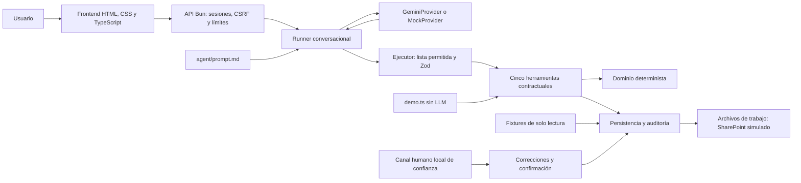
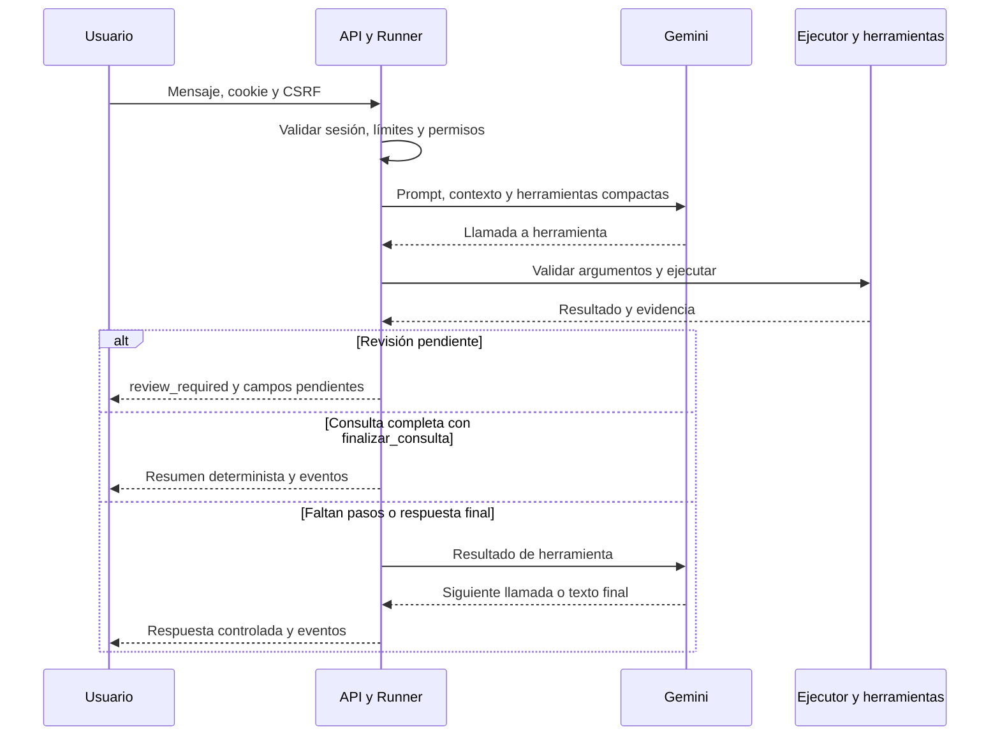

# Solución técnica — Reto 2: gestión inteligente de contratos

**Periferia IT Group · Evaluación local · Fase 8.3**

Documento contrastado con el código y las pruebas del repositorio. La instalación
y el uso se describen en [README.md](README.md#cómo-ejecutar-el-proyecto-localmente).
El alcance exigido se conserva en [PRD.md](PRD.md). La aplicación está implementada
localmente; **la URL pública permanece pendiente**. El cumplimiento de los
entregables es parcial: la ejecución local no sustituye el despliegue público
exigido por el PRD, que contempla penalización por su ausencia.

## 1. Resumen ejecutivo

El problema descrito por el PRD es un maestro congelado desde el 30 de mayo de
2026 y contratos dispersos en correos, con recepción concentrada en los que
requieren póliza. Eso dificulta identificar duplicados, actualizar otrosíes y
seguir vencimientos u obligaciones de garantías.

La solución reúne un chat, cinco herramientas y un motor contractual verificable.
Gemini interpreta la solicitud y propone llamadas; el código extrae, clasifica,
valida, autoriza y persiste. La IA no tiene acceso directo al maestro ni puede
otorgar aprobaciones. Los beneficios buscados son recepción consistente,
visibilidad de pendientes y trazabilidad; no se midieron ahorros ni precisión
estadística y no se atribuyen cifras de productividad al prototipo.

Hay dos recorridos complementarios: el chat permite consultar y revisar con
Gemini; `demo.ts` ejecuta las reglas y persistencia simulada sin LLM. El canal
HTTP bloquea todos los registros contractuales. El motor dispone de escritura
controlada para consumidores locales de confianza y de revisión humana probada
con escenarios sintéticos. **msg-006 no se registra en la demo del buzón.**

## 2. Arquitectura y responsabilidades



| Componente | Módulo real y responsabilidad |
|---|---|
| Frontend | [web/index.html](web/index.html), [styles.css](web/styles.css), [app.ts](web/app.ts), [api.ts](web/api.ts), [render.ts](web/render.ts): chat, estados, eventos y revisiones como texto seguro. |
| Arranque y recursos | [src/server.ts](src/server.ts) y [src/http/web.ts](src/http/web.ts): proveedor, carpeta temporal, Bun.serve y compilación del frontend en memoria. |
| API | [src/http/api.ts](src/http/api.ts) y [presentation.ts](src/http/presentation.ts): acceso por sesión, validación y proyección pública sin tickets privados. |
| Agente | [runner.ts](src/agent/runner.ts), [session.ts](src/agent/session.ts), [task.ts](src/agent/task.ts): ciclo, contexto, presupuestos y comprobación de revisiones solicitadas. |
| Proveedores | [provider.ts](src/agent/provider.ts), [gemini-provider.ts](src/agent/gemini-provider.ts), [mock-provider.ts](src/agent/mock-provider.ts): interfaz propia, SDK oficial o guion determinista. |
| Ejecución | [tool-executor.ts](src/agent/tool-executor.ts), [tool-references.ts](src/agent/tool-references.ts): validación, permisos y resolución de originales conservados en el servidor. |
| Herramientas | [src/tools/contratos.ts](src/tools/contratos.ts): contrato Zod, errores controlados y auditoría común de las cinco operaciones. |
| Dominio | [src/domain/](src/domain/): extracción, normalización, clasificación, preparación del registro, revisión, confirmación y alertas. |
| Datos y persistencia | [src/storage/](src/storage/): CSV, catálogo, buzón, comprobación de fuentes, escritura y recuperación. |
| Human-in-the-Loop | [human-review.ts](src/agent/human-review.ts), [review.ts](src/domain/review.ts), [confirmation.ts](src/domain/confirmation.ts), [persistence.ts](src/storage/persistence.ts): correcciones y decisiones ligadas a versiones. |

La separación permite probar las reglas sin modelo y cambiar el adaptador sin
reescribir el dominio. El servidor no contiene reglas contractuales; el frontend
no ejecuta herramientas. No hay base de datos, RAG, Exchange ni SharePoint real.
No existe una carpeta `src/knowledge/`: el conocimiento operativo está expresado
en el dominio y esta documentación, con comportamiento conversacional en el
prompt separado; es una diferencia de organización frente a PRD 6.5.

La API conserva seis rutas: health, creación de sesiones, envío y lectura de
mensajes, lectura de eventos y lectura de revisiones. Frontend y API comparten
origen. Las firmas HTTP y ejemplos completos están en el README.

## 3. Ciclo del agente y controles de ejecución

1. El usuario envía texto. La API verifica origen, cookie, CSRF, tamaño y límites;
   identifica una sesión del runner y fija `allowRegistration: false`.
2. El runner añade el mensaje, carga `agent/prompt.md` y determina si la tarea
   exige revisar o validar mensajes concretos. Gemini recibe los cuatro turnos
   recientes completos; el historial local se conserva dentro de sus límites.
3. Gemini interpreta la solicitud y devuelve texto o function calls. El SDK tiene
   desactivadas la ejecución automática de funciones y la continuación automática;
   tampoco se configuran reintentos automáticos de solicitudes.
4. El ejecutor acepta solo las cinco herramientas, comprueba IDs de llamada y
   valida argumentos con Zod. En el transporte compacto resuelve `contrato_ref`
   contra la extracción o ticket original de esa sesión, mensaje y tipo.
5. La herramienta consulta fuentes y aplica código determinista. Su resultado
   se registra como evento y vuelve al contexto como resultado de herramienta.
6. Si hace falta otro paso, el runner solicita otra inferencia. Las dependencias
   esperan su resultado; las llamadas de un lote se ejecutan secuencialmente.
7. Una revisión pendiente detiene el turno y deja rastro de llamadas omitidas.
   La respuesta final muestra hechos resumidos desde las herramientas usadas.
8. La API audita el cierre y devuelve respuesta, eventos, revisiones, estado y
   consumo público. El frontend actualiza sus paneles al terminar, sin streaming.



La segunda inferencia no es obligatoria: `finalizar_consulta=true` permite cerrar
consultas completas de buzón, extracción o alertas con un resumen determinista.
Para revisar qué falta no basta extraer: `task.ts` exige validar cada mensaje
objetivo en el turno actual. Admite una solicitud correctiva adicional, dentro
del presupuesto; si no se completa, termina como `incomplete`.

| Límite | Configuración actual |
|---|---|
| Iteraciones por turno | `AGENT_MAX_ITERATIONS=10`; el esquema admite hasta 25. |
| Herramientas por turno | `AGENT_MAX_TOOL_CALLS=20`; un lote que exceda el restante se rechaza antes de ejecutarlo. |
| Tokens por sesión | `.env.example` propone `AGENT_MAX_TOKENS=60000`; sin variable, el valor predeterminado del motor/configuración es 20000. |
| Timeout por inferencia | `AGENT_PROVIDER_TIMEOUT_MS=15000`, máximo configurable 60000 ms. Una respuesta tardía no ejecuta herramientas. |
| Contexto local | 80 mensajes y 200000 caracteres por defecto; el límite local puede alcanzarse aunque la ventana enviada a Gemini sea menor. |
| Generación Gemini | Un candidato y `maxOutputTokens` limitado al restante lógico y a 8192. |

Se distinguen `final`, `review_required`, `incomplete`, `tool_error`, `error` y
`limit`. Un error de proveedor no mata la sesión; un error de herramienta se
conserva y no se presenta como éxito. En HTTP se distinguen 502 y timeout 504.
Los documentos y correos se tratan como datos no confiables, no instrucciones.
El prompt lo exige y los permisos se comprueban en código. Esto reduce el riesgo
de prompt injection, pero no constituye una prueba universal de veracidad del
texto libre del modelo cuando responde sin herramientas.

## 4. Cinco herramientas contractuales

Todas se exportan desde [src/tools/contratos.ts](src/tools/contratos.ts) como
objetos con `description`, `args` y `execute(args, ctx)`. Devuelven un string JSON
`{ ok: true, data }` o `{ ok: false, error }`; el contenedor controla excepciones.
Un fallo posterior de auditoría puede añadir `error_auditoria`: hay que revisar
el resultado, pues una operación ya aplicada no desaparece por ese fallo.

| RF / nombre visible | Entrada directa | Resultado y lógica principal | Validación y seguridad |
|---|---|---|---|
| RF-01 `contratos_leer_buzon` | `{}` | `leer_buzon.execute`: `{ mensajes[] }`, omitiendo procesados; usa `readMailbox`, `storageSnapshot` y `evaluateRegistration` para distinguir documentos y problemas. | Valida correos/adjuntos y continúa ante errores individuales; una cotización no se presenta como contrato. |
| RF-02 `contratos_extraer` | `{ mensaje_id }` | `extraer.execute` → `inspectMessageInput` → `extractContract`: campos, confianza, evidencia, tipo documental, condiciones y revisiones documentales. | ID seguro, TXT referenciado por el correo, fuentes verificadas y esquema de extracción; no inventa ausencias. |
| RF-03 `contratos_validar` | `{ mensaje_id, contrato }`, siendo `contrato` la extracción íntegra | `validar.execute` → `evaluateRegistration` → `validateContract`: clasificación, diferencias, motivos, evidencias, elegibilidad y `contrato` como ticket de registro. | Rechaza extracción alterada, verifica fuentes y aplica RN1–RN5 contra maestro y catálogo actuales. |
| RF-04 `contratos_registrar` | `{ mensaje_id, contrato, confirmado? }`, siendo `contrato` el ticket íntegro | `registrar.execute` → `persistRegistration` o `persistConfirmedRegistration`: acción, ID, revisiones y ruta de archivo cuando corresponde. | Revalida ticket y versiones; `confirmado=true` exige autorización humana local aprobada. HTTP lo bloquea siempre. |
| RF-05 `contratos_alertas` | `{ hoy: "YYYY-MM-DD" }` | `alertas.execute` → `generateAlerts` / `renderAlerts`: ruta, próximos, vencidos, pólizas, altas desde el corte y obligaciones pendientes. | Fecha real validada; comprueba versiones de maestro/historial antes de escribir el reporte. No modifica contratos. |

`ctx` contiene `directory`, `sessionId` y, opcionalmente, reloj y autorización
local confiables; no son argumentos que el modelo pueda elegir. En Gemini las
dos operaciones con objetos grandes usan **`contrato_ref`**, no `contrato`;
el adaptador resuelve el original antes de invocar estas firmas. Solo las tres
consultas simples admiten `finalizar_consulta` en ese transporte. Los esquemas
directos del PRD se mantienen para `demo.ts` y otros consumidores locales.

## 5. Extracción, reglas y decisiones sobre los datos

### Extracción y confianza

[extraction.ts](src/domain/extraction.ts) reconoce cabeceras y cláusulas TXT
mediante regex y heurísticas; [normalization.ts](src/domain/normalization.ts)
normaliza importes, fechas, monedas e identificadores sin adivinar ambigüedades.
Cada campo conserva `extraido`, `normalizado`, `confianza` y `evidencia`.

| Situación reconocida | Tratamiento implementado |
|---|---|
| Dato explícito e inequívoco | Habitualmente 0.98, con evidencia literal. |
| Valor por demanda | Valor `null`, confianza 0.6, indicador de indeterminación; revisión. |
| Separador, moneda o condición ambiguos | Generalmente 0.4 y normalizado `null`. |
| Importe estimado de cotización | 0.65; no convierte la cotización en contrato. |
| Fechas dependientes de una firma no disponible | 0.3; no se usa la fecha del correo como firma. |
| Campo ausente | `null` y confianza 0. No es una probabilidad calibrada. |

El país se toma del cliente explícito; **NIT no equivale a Colombia**. La validación
solo puede completar un país ausente desde contratos del mismo identificador
tributario con país uniforme, conservando origen `maestro` y la regla aplicada.
No se recorta el objeto durante extracción; superar los 200 caracteres del
registro final requiere revisión. Comercial, fuente, fecha de registro, ruta y
estado de póliza se enriquecen después; no se inventan en el TXT.

### RN1–RN5 y precedencia

| Regla | Comportamiento de [validateContract](src/domain/validation.ts) |
|---|---|
| RN4: rechazado | Sin adjunto contractual interpretable, cotización o tipo desconocido. En contratos reconocidos sin cliente ni objeto identificables se rechaza; información esencial incompleta se remite a revisión. |
| RN1: duplicado | Contrato ordinario con mismo ID y valores no nulos iguales en `valor`, `fecha_inicio` y `fecha_fin`. No propone modificación. Conflictos de moneda, identidad u otros campos conservan RN1, con advertencia/revisión. |
| RN2: actualización | Base por ID o NIT + objeto semejante y diferencias, o documento identificado como otrosí. Base inexistente o ambigua bloquea; no se elige arbitrariamente una fila. |
| RN3: nuevo | Contrato sin coincidencia con una base; todavía puede requerir revisión. |
| RN5: revisión | Confianza inferior a 0.8, esenciales ausentes, contradicciones o incoherencias impiden elegibilidad. El umbral 0.8 sí es aceptado. |

Primero se descartan documentos no contractuales y se buscan bases. Se prioriza
ID; si no coincide, NIT y objeto necesitan confianza ≥ 0.8 y similitud ≥ 0.9.
Con base única, RN1 precede a RN2 en contratos ordinarios; **un otrosí explícito
aplica RN2 incluso si los tres valores RN1 no cambian**. RN3 queda para ausencia
de coincidencias. RN5 determina si la operación propuesta está lista.

La similitud es **Jaccard de conjuntos de palabras**, tras quitar acentos,
normalizar mayúsculas y signos: intersección / unión. Ignora orden y repeticiones;
no comprende equivalencia jurídica y puede perder coincidencias por redacción.
Se usa junto al NIT y nunca sustituye la identificación humana ante conflictos.

En un otrosí se hereda la base y se aplican únicamente cambios expresos soportados;
un cambio no interpretable no borra el valor histórico. La extracción actual de
modificaciones soporta valor, moneda y fecha final; otras cláusulas requieren
evolución del extractor. No se permite renombrar la fila ni sobrescribir sus
metadatos de recepción durante una actualización.

Un alta con póliza queda `pendiente`; sin póliza, `no_aplica`. En actualizaciones
se conserva el estado histórico. Para CT-2026-011, `vigente` no acredita la
ampliación exigida: se registra `AMPLIAR_GARANTIAS` como obligación pendiente.
La exención de msg-002 procede del **correo**, con evidencia y origen explícitos.
Un comercial desconocido produce advertencia, no bloqueo por sí solo; si llega
a persistir un alta elegible, se conserva su email como responsable verificable.

## 6. Seis casos y resultado determinista

Fecha de la demo: **2026-09-03**. Se parte de una copia del maestro con ocho filas.

| Mensaje | Documento | Clasificación | Esperado por el PRD | Verificado en la primera pasada y motivo |
|---|---|---|---|---|
| msg-001 | Contrato Industrias Delta | nuevo | Alta con póliza pendiente | Registrado; obligación explícita, campos válidos y `estado_poliza=pendiente`. |
| msg-002 | Contrato Corporación Andina | nuevo | Alta sin póliza | Registrado, `no_aplica`; la exención se evidencia en el correo. |
| msg-003 | Otrosí de CT-2026-011 | actualizacion | Modificación e historial | Actualizado con fecha final y valor/moneda documentados; archivo del otrosí y ampliación de garantías pendiente. |
| msg-004 | Reenvío Clínica San Rafael | duplicado | Sin escritura contractual | Duplicado según RN1; se conserva maestro/archivo y se registra procesamiento. |
| msg-005 | Cotización Universidad | rechazado | Rechazo con motivo | Rechazado por RN4; no crea contrato. |
| msg-006 | Contrato marco CM-2026-03 | nuevo, pendiente_revision | Bloqueado hasta aclarar | Sin registrar: valor, moneda, fecha_inicio, fecha_fin, requiere_poliza y objeto pendientes; remitente desconocido advertido. |

El maestro pasa **8 → 10 → 10**. La primera pasada aplica dos altas y una
actualización; la segunda devuelve cinco `ya_procesado` y un pendiente. El
otrosí puede seguir clasificándose como actualización por RN2, pero la idempotencia
evita aplicarlo dos veces. Se verifican 53 eventos de auditoría y tres operaciones
contractuales en el historial, según esta demo y sus dos pasadas.

El reporte contiene dos próximos vencimientos, dos vencidos, dos pólizas no
vigentes, dos altas desde el corte y una ampliación pendiente. El corte usa
`fecha_registro` entre 2026-05-30 y `hoy`; no cuenta una actualización histórica
como un contrato nuevo. No hay fechas de vencimiento de pólizas en el maestro:
no se infieren de la fecha final del contrato.

La confianza no obliga a resolver solo dos campos de msg-006: la validación real
detecta seis. Su valor indeterminado se conserva `null`; representar cero en el
maestro exige tratamiento humano explícito, sin confundirlo con un importe cero
real. Los ejemplos de éxito de revisión usan contratos sintéticos separados.

## 7. Revisión humana, persistencia y trazabilidad

### Human-in-the-Loop

El flujo es **revisión → correcciones → solicitud → decisión → revalidación →
persistencia**. Cada corrección especifica campo, valor, justificación y
procedencia; conserva anterior, revisor y fecha. Se vuelve a validar, y si
quedan pendientes no se crea una autorización apta para registrar.

La solicitud liga mensaje, adjunto, maestro, fuentes, valores y revisor mediante
hashes SHA-256. Tiene estados pendiente/aprobada/rechazada/utilizada y caduca por
defecto a los 30 minutos. Aprobar no registra. La persistencia exige decisión
coherente, versión vigente y uso único; consumir la aprobación y cambiar los
archivos forman parte del mismo lote recuperable.

En el agente, la aprobación también queda ligada a la sesión y al ticket. Cambiar
documento, catálogo, maestro, datos o reloj relevante obliga a revisar otra vez.
La idempotencia evita filas repetidas y la solicitud utilizada no autoriza otra
operación. `confirmado=true` o «confirmo» no sustituyen estos controles.

Los roles se separan por responsabilidades: usuario solicita, modelo propone
herramientas, canal externo decide. **La identidad implementada es
`modo: simulado_local`**, no SSO ni autenticación empresarial. El acceso local a
esos métodos es una frontera de confianza; sus hashes no son firmas de un tercero
ni protegen de un administrador capaz de reescribir todos los archivos.
La consola `bun run revision` demuestra correcciones y aprobación sobre un
contrato sintético; no completa artificialmente msg-006.

### Archivos y consistencia

Cada arranque HTTP, demo y consola de demostración utiliza su propia carpeta
temporal, con fixtures copiados. Las rutas siguientes son relativas a ese
directorio de trabajo; no al `out/` operativo del repositorio.

| Ruta | Finalidad |
|---|---|
| `out/sharepoint/maestro-contratos.csv` | Copia inicial del maestro y estado contractual de trabajo. |
| `out/sharepoint/Contratos/<año>/<cliente-slug>/` | TXT archivados de altas; otrosíes en `otrosies/<mensaje_id>/` sin pisar el documento previo. |
| `out/sharepoint/historial.jsonl` | Cambios contractuales, diferencias anterior/propuesto, versiones, evidencias y obligaciones pendientes. |
| `out/procesados.json` | Mensajes terminales y huella de su entrada para idempotencia; pendientes no se marcan como procesados. |
| `out/log.jsonl` | Auditoría operativa: consultas, validaciones, errores, decisiones, llamadas y métricas según el consumidor. |
| `out/alertas.md` | Reporte generado para la fecha solicitada. |
| `out/confirmaciones/<uuid>.json` | Solicitudes humanas privadas y estado de su decisión/consumo. |
| `out/.transaccion.json` | Diario de recuperación del lote de archivos; no es un reporte para el navegador. |

[persistence.ts](src/storage/persistence.ts) serializa operaciones por directorio
en un único proceso. Antes de registrar vuelve a evaluar fuentes, elegibilidad,
reglas y ticket. [audit.ts](src/storage/audit.ts) guarda las imágenes anterior y
posterior, escribe mediante temporales y renombrados, y comprueba el hash del
maestro antes de cada reemplazo. La autorización se comprueba también durante
el lote confirmado.

Un fallo revierte el lote preparado si los estados coinciden. Si hay cambios
externos incompatibles, la recuperación se bloquea y conserva el diario para
revisión. Un diario confirmado permite finalizar su limpieza sin repetir el
registro. Esto no equivale a una transacción distribuida ni garantiza aislamiento
frente a varios procesos: se requiere **un único escritor local**.

Duplicados y rechazados no alteran contratos, pero sí pueden marcar el mensaje
procesado y dejar auditoría. El historial contractual registra las altas y
actualizaciones, no cada consulta. Las advertencias de duplicados conservan
trazabilidad aun cuando RN1 prohíbe modificar el maestro.

## 8. Gemini: elección, consumo y estimación de costos

Se usa el SDK oficial **`@google/genai` 2.30.0**, con modelo predeterminado
**`gemini-3.5-flash-lite`**, confirmado en `src/agent/config.ts`, `.env.example`
y las pruebas manuales compartidas por el usuario. Se eligió una integración
con function calling y API Key accesible desde AI Studio, manteniendo al modelo
fuera de las reglas y de los permisos. No se hicieron comparativas estadísticas
con otros modelos; una clave propia no garantiza gratuidad ni acceso universal.

Las variables son `AGENT_PROVIDER`, `GEMINI_API_KEY`, `GEMINI_MODEL`,
`AGENT_MAX_ITERATIONS`, `AGENT_MAX_TOOL_CALLS`, `AGENT_MAX_TOKENS` y
`AGENT_PROVIDER_TIMEOUT_MS`. Las tarifas no están embebidas en el programa.

### Tarifa verificada

**Consulta: 2026-10-20 UTC**. Para este modelo y servicio **Standard**, Google
publica estos precios en USD; no se aplican aquí tarifas Batch, Flex o Priority.
Fuente: [tarifas oficiales de Gemini](https://ai.google.dev/gemini-api/docs/pricing#gemini-3.5-flash-lite).

| Categoría | Tarifa Standard pagada |
|---|---|
| Entrada | USD 0.30 por millón de tokens. |
| Salida, incluido razonamiento | USD 2.50 por millón de tokens. |
| Entrada en caché | USD 0.03 por millón de tokens. |
| Almacenamiento de caché | USD 1.00 por millón de tokens por hora. |

La página distingue nivel gratuito y pagado; elegibilidad, cuotas y condiciones
dependen del proyecto. No se activan cachés explícitas, búsqueda de Google, Maps
ni otras herramientas facturables del proveedor en esta implementación.

### Qué se mide y qué se factura

El adaptador lee `usageMetadata`: `promptTokenCount`, `candidatesTokenCount`,
`totalTokenCount`, `thoughtsTokenCount` y `cachedContentTokenCount`. Los publica
como entrada, salida, total, razonamiento y caché. El prompt incluye contexto y
esquemas de herramientas: una respuesta visible corta no implica poca entrada.
Cada inferencia vuelve a procesar contexto; no existe memoria remota gratuita.

El contador de entrada incluye la parte en caché. El de candidatos y el de
razonamiento son categorías distintas; no sumar otra vez el total. El proveedor
también define `toolUsePromptTokenCount`, que este adaptador no expone por
separado: no debe darse por cero si aparece una diferencia. Véase la
[definición oficial de UsageMetadata](https://ai.google.dev/api/generate-content#UsageMetadata).

Para estimar este flujo de texto, definiendo `I` como toda la entrada facturable,
`C` como su parte cacheada y `O` como candidatos más razonamiento facturable:

```text
Costo de inferencias (USD) = ((I - C) × 0.30 + C × 0.03 + O × 2.50) / 1 000 000
Costo de conversación = suma de todas sus inferencias
```

Si se informan prompts adicionales de herramientas, deben incorporarse a `I`
una sola vez, conciliando su tratamiento con el proveedor; el contador local
de entrada no los desglosa. Si se habilitara caché explícita, añadir almacenamiento
por tokens y horas, creación y demás cargos según la política del proveedor.
Con contadores ausentes
(`null`) el costo exacto no se conoce; no se sustituyen por cero. La factura
real depende de los metadatos completos, modalidad, descuentos e impuestos.

**Ejemplo propio, ilustrativo:** una conversación de dos consultas. **Por cada
consulta**, sumando todas sus inferencias, se suponen 5000 tokens de entrada,
300 de respuesta y 200 de razonamiento. Esos valores corresponden a cada
consulta, no al conjunto de ambas.

| Alcance | Entrada (`I`) | Respuesta | Razonamiento | Salida facturable (`O`) |
|---|---|---|---|---|
| Cada consulta | 5000 | 300 | 200 | 500 |
| Conversación completa: dos consultas | 10000 | 600 | 400 | 1000 |

Sin caché ni cargos adicionales, el costo de la conversación es
`(10000 × 0.30 + 1000 × 2.50) / 1000000 = USD 0.0055`.

| Volumen ilustrativo | Consultas del ejemplo | Estimación USD |
|---|---|---|
| 100 conversaciones | 200 | 0.55 |
| 1000 conversaciones | 2000 | 5.50 |
| 10000 conversaciones | 20000 | 55.00 |

Una consulta puede usar varias inferencias; esos volúmenes no presuponen una
relación de una llamada por mensaje. Las cantidades del ejemplo son supuestos,
no una medición ni una promesa de facturación de los seis casos.

El runner acumula el mayor entre el total informado y entrada + salida +
razonamiento, sin sumar dos veces categorías. `usageComplete=false` indica
información incompleta. El presupuesto se verifica después de recibir consumo:
60000 es un freno lógico de sesión, **no un techo monetario garantizado**; la
entrada de una llamada en curso puede superarlo y un timeout puede tener costo
desconocido. No hay presupuesto global de gasto para varias sesiones.

Ya se redujo contexto con referencias a originales, esquemas compactos, ventana
de cuatro turnos y cierres deterministas. Para producción: presupuestos globales,
cuotas por identidad, alertas de gasto y conciliación con facturación; evaluar
caché solo con mediciones. No se promete ahorro por caché implícita.

## 9. Propuesta de regla de gobierno corporativo para la gestión contractual

**Política propuesta, pendiente de aprobación corporativa; no es una estructura
verificada de Periferia ni una automatización ya implantada.**

### Principio, recepción y responsables

Ningún contrato se incorpora o modifica sin identificación documental, datos
obligatorios validados, evaluación de duplicidad, responsable identificado,
evidencia trazable y confirmación humana cuando corresponda.

Control documental administraría `contratos@empresa.example` (buzón propuesto,
no operativo). Cada comercial enviaría contratos firmados, otrosíes y actas de
terminación, **con o sin póliza**, dentro de un día hábil de firma, con documento
legible, base y garantías. Asunto: `[CONTRATO|OTROSI|TERMINACION] ID - Cliente - País - Fecha`.
Se propone acuse automático en 15 minutos con recepción y faltantes, al integrar
correo. **El prototipo no envía acuses.**

| Rol propuesto | Responsabilidad |
|---|---|
| Comercial o solicitante | Entregar expediente, identificar contraparte y responder aclaraciones. |
| Responsable contractual / asesor jurídico | Resolver excepciones; designar responsable y apoyo externo si no existe área jurídica interna. |
| Control documental | Cotejar originales, mantener versiones y seguir alertas. |
| Aprobador autorizado | Decidir con identidad verificable y facultades formalizadas. |
| Administrador de plataforma | Proteger accesos, secretos y respaldos; administrar no otorga facultades contractuales. |

### Matriz de decisión operativa

| Situación | Automatización permitida por la política | Revisión humana | Responsable | Evidencia obligatoria |
|---|---|---|---|---|
| Alta completa | Registrar tras controles y permisos. | Según facultades/excepciones. | Control documental. | Contrato firmado y validación. |
| Otrosí | Vincular base y preparar cambio parcial. | Ambigüedades/facultades. | Responsable contractual. | Otrosí, versión y diferencias. |
| Duplicado | Conservar maestro; auditar recepción. | Contradicciones. | Control documental. | RN1 y conflictos. |
| Cotización / inválido | Separar del maestro. | Clasificación reclamada. | Solicitante. | Motivo y archivo. |
| Baja confianza / incompleto / sin firma | Bloquear y pedir aclaración. | Obligatoria. | Responsable y aprobador. | Correcciones y soporte. |
| Póliza / ampliación | Alertar; no presumir cumplimiento. | Verificar constitución/ampliación. | Responsable contractual. | Póliza/endoso y obligación. |
| Vencimiento próximo | Alertar. | Decidir renovación/cierre. | Dueño del contrato. | Fecha y actuación. |
| Excepción / cambio de versión | Reevaluar. | Obligatoria. | Aprobador. | Fuentes y nueva decisión. |

El responsable contractual recibiría excepciones no resueltas; plazos y
facultades quedarían aprobados por la empresa, sin inventar montos. Conservar
documentos, versiones y decisiones según un calendario aprobado; sin él, no
eliminar automáticamente. Revisar auditoría operativa y cambios por separado.

Para junio–agosto de 2026: campaña única de inventario comercial contra
facturación, recepción, deduplicación y conciliación de faltantes por responsable.
Indicador mensual: **contratos facturados presentes en maestro / total de
contratos facturados**, explicando pendientes. No hay campaña ejecutada, resultado
medido ni meta inventada.

**Regla resumida: la IA prepara y verifica; solo las personas con facultades
formalizadas asumen la decisión contractual, con evidencia y versión trazables.**

## 10. Decisiones técnicas y alternativas

| Decisión | Motivo y límite | Alternativa no adoptada |
|---|---|---|
| Bun + TypeScript + Zod | Runtime y compilador existentes, herramientas tipadas y una sola aplicación local. | Express/Nest añadirían capas sin necesidad actual. |
| Extracción determinista antes del LLM | Reglas y evidencia reproducibles sin pagar inferencias; cobertura limitada al lenguaje TXT soportado. | Extracción libre por modelo requeriría comprobar propuestas y no resolvería la autorización. |
| CSV y diario local | Reflejan los fixtures y permiten explicar recuperación e idempotencia. | Base transaccional es evolución para concurrencia y operación real. |
| Referencias compactas al modelo | Evitan reconstruir objetos grandes y conservan originales comprobables en el servidor. | Reenviar contratos y tickets completos aumenta contexto y posibilidades de alteración. |
| HTML/CSS/TypeScript en el mismo origen | Interfaz sin framework adicional, cookies y CSRF sencillos de operar. | SPA y API en dominios separados exigirían más configuración. |
| Escritura HTTP bloqueada | Separa demostración anónima de aprobación humana confiable. | Aceptar «confirmo» como autorización sería incompatible con los controles acordados. |

Supuestos: datos ficticios, documentos TXT ya extraídos, fechas ISO para reglas,
un escritor por directorio y confianza en el maestro validado como fuente de
herencia. La confianza 1 de una herencia acredita procedencia, no certeza jurídica.
No se verifican firmas, autoridad del remitente ni autenticidad del contrato real.

## 11. Seguridad, riesgos y evolución

| Control implementado | Límite actual y siguiente paso |
|---|---|
| API Key solo en backend, `.env` excluido, compilación web con `env: disable`; errores controlados y proyección pública. | No hay gestor empresarial de secretos. Restringir credenciales y revisar cualquier log antes de compartirlo. |
| Credencial aleatoria de sesión de 256 bits, cookie HttpOnly/SameSite=Strict, hash y comparación de tiempo constante; CSRF independiente en memoria. | Protege sesión anónima, no identidad ni rol. Cookie Secure cuando el origen configurado es HTTPS; falta despliegue TLS. |
| Origen y Host exactos; no se confía en cabeceras forwarded del cliente. | Definir proxy confiable y control de acceso antes de exponerlo. |
| 50 sesiones, TTL absoluto 30 min, 2 turnos simultáneos, un turno por sesión; 60 solicitudes/min/IP, 5 creaciones/min/IP y 10 mensajes/min/sesión. | Límites por proceso y por IP; no son cuota de cuenta ni presupuesto monetario global. |
| Mensajes ≤10000 caracteres, cuerpos ≤64 KiB y 5 s para recibirlos; Zod en HTTP, herramientas y dominio. | Validación estructural no sustituye autenticidad documental. |
| Lista cerrada de herramientas, datos documentales no confiables, referencias verificadas y permisos locales. | La inyección puede afectar interpretación o texto; no se atribuye inmunidad completa. Ampliar evaluación adversarial. |
| Frontend con `textContent`, CSP y tres recursos estáticos públicos. | Sin Markdown dinámico ni archivos arbitrarios; pendiente comprobación en dispositivos reales y accesibilidad completa. |
| Rutas relativas verificadas, segmentos seguros, comprobación de adjuntos, rechazo de enlaces en salida. | El usuario del sistema de archivos sigue siendo privilegiado. Aislar almacenamiento y permisos de producción. |
| Revalidación de hashes, diario y comprobación de autorización de un uso. | Hashes y logs locales son modificables por administradores; evolucionar a auditoría protegida y almacenamiento transaccional. |

La evolución prioritaria es identidad empresarial y roles para el aprobador,
almacenamiento transaccional con concurrencia controlada, conectores reales de
correo/SharePoint, extracción PDF/OCR evaluada, monitoreo y límites de gasto.
Después, despliegue HTTPS con secretos gestionados, retención aprobada y auditoría
protegida. Es trabajo futuro; no se implementa como parte de este documento.

Limitaciones adicionales: los reportes del temporal son compartidos por las
sesiones de ese proceso y `alertas.md` refleja la última consulta; reiniciar pierde
conversaciones; los temporales no se depuran automáticamente. No hay integración
con aseguradoras ni un flujo para acreditar y cerrar ampliaciones pendientes.
No se realiza revisión jurídica ni verificación de firma.

## 12. Ejecución, evidencia y preparación de defensa

Seguir primero el README para clonar y configurar `.env` con una clave propia.
Los comandos reales son:

```powershell
bun install
bun run server
# En otra terminal, dentro del mismo proyecto:
bun run typecheck
bun test
bun run demo
```

Gemini requiere configuración válida. Para evaluar HTTP sin modelo:
`$env:AGENT_PROVIDER = "mock"` y `bun run server`; el navegador abre la dirección
local impresa, normalmente `http://127.0.0.1:3000/`. El mock anuncia su guion fijo
buzón → revisión → registro bloqueado y no interpreta preguntas libres.
La demo y las pruebas no necesitan clave ni consumen Gemini.

| Verificación de cierre | Resultado ejecutado |
|---|---|
| `bun run typecheck` | 63 archivos sin errores. |
| `bun test` | 281 pruebas aprobadas, 0 fallos, 2072 comprobaciones, en 15 archivos. |
| `bun run demo` | 31/31 aserciones; 8 → 10 → 10, msg-006 pendiente. |
| Integridad | Comparación SHA-256 de PRD, AGENTS, fixtures, `.env`, configuración, código, pruebas y `out/` operativo antes/después de esta fase documental. |

Tipos, pruebas y demo se ejecutaron nuevamente en la revisión final del
2026-10-20, con los resultados de la tabla y sin consumir Gemini.

Las suites cubren datos y normalización, RN1–RN5, revisión sintética, transacciones,
idempotencia, fallos de I/O, límites del agente, transporte Gemini simulado,
finalización de tareas, autorización HTTP y DOM del frontend. Los tests del
adaptador usan respuestas inyectadas; no certifican disponibilidad ni calidad
estadística del proveedor real. Las pruebas manuales Gemini compartidas por el
usuario son evidencia funcional separada, no se repitieron con consumo en esta fase.

La preparación anterior también verificó una copia limpia sin `.env`, AGENTS,
dependencias ni `out/` iniciales. Después de instalar, pasaron tipos, las 281
pruebas, demo e inicio HTTP con mock. [Captura del frontend](docs/evidencias/fase-8-1b-chat.png).

Para la defensa: mostrar primero la demo y sus dos pasadas, después el chat con
eventos/revisión, y finalmente explicar por qué «confirmo» queda bloqueado.
Preguntas clave: quién decide y con qué evidencia; cómo se evita repetir un
registro; qué sucede si cambia el maestro; por qué los tokens superan el texto
visible; y qué queda pendiente para una aprobación empresarial y URL pública.

## 13. Cobertura, diferencias frente al PRD y entregables

**No se declaran completos los cuatro entregables.** La URL pública sigue
pendiente y la documentación de cierre aún requiere publicación en GitHub.

| Entregable del PRD | Estado al preparar la publicación |
|---|---|
| Repositorio con la aplicación | Código, frontend, API y evidencia publicados; actualización documental pendiente. Las limitaciones funcionales se detallan debajo. |
| Link público para probar el agente | **Pendiente: no hay URL pública desplegada.** La ejecución local durante la defensa implica la penalización de -10 prevista en PRD 9.3. |
| `demo.ts` sin modelo | Publicado y verificado: 31/31 aserciones, sin LLM. |
| `SOLUCION.md` | Redactado y revisado localmente; pendiente de inclusión y publicación con el enlace del README. |

| Requisito | Estado verificable | Diferencia o pendiente |
|---|---|---|
| HU-1 / RF-01 | Implementado: buzón simulado, pendientes y rechazo de cotizaciones. | No hay correo corporativo real. |
| HU-2 / RF-02 | Implementado para TXT con evidencia y confianza. | PDF/OCR no implementados; otrosíes y redacciones no soportadas requieren revisión/evolución. |
| HU-3 / RF-03 | Implementado: RN1–RN5, conflictos, catálogo y revisiones. | La similitud elegida es Jaccard, no semántica jurídica. |
| HU-4 / RF-04 | Motor y persistencia controlada implementados; interfaz pública de consulta. | Registro desde chat y aprobación empresarial no disponibles. `confirmado=true` se endurece con solicitud ligada a datos; no es un bypass. |
| HU-5 / RF-05 | Implementado: vencimientos, pólizas y gap, con fecha fija. | Sin fecha de expiración de pólizas no se calcula su vencimiento exacto. |
| HU-6 y ciclo | Errores, límites, estados incompletos y llamadas visibles probados. | No hay garantía semántica universal sobre toda petición compuesta. |
| Confirmación del chat / CA3 | Revisión pública visible; autorización local de un uso probada. | El «confirmo» literal del ejemplo del PRD no autoriza ni registra; requiere canal confiable y valores completos. |
| Demo / PRD 6.6 | Seis casos y dos pasadas, sin LLM. | La llamada `confirmado=true` sin autorización demuestra bloqueo; no registra msg-006. El éxito autorizado se demuestra por separado con datos sintéticos. |
| RN6 y RN7 | Fixtures conservados, maestro copiado y auditoría de operaciones. | No es almacenamiento corporativo inmutable ni multiproceso. |
| Repositorio, frontend y arranque | Implementados; un comando inicia web y API. | `localhost` solo es accesible desde el equipo del evaluador. |
| `SOLUCION.md` y gobierno | Creados en Fase 8.3. | La política propuesta requiere adopción empresarial. |
| URL pública / PRD 9.3 | **Pendiente: no desplegada.** | La evaluación local no satisface literalmente el link público; el PRD contempla penalización por esa ausencia. |
| Módulo reutilizable bonus | No implementado como paquete `modulo/`. | Las herramientas son importables; eso no equivale a entregar el bonus completo. |

**Verificación de evidencias en GitHub (2026-10-20):** se consultó el árbol
recursivo remoto de `main`, sin truncamiento, en el commit
[`f4c21837b1601cde1184b3fee7411cf4903f6553`](https://github.com/jhcuadrosp/periferia-reto-02/tree/f4c21837b1601cde1184b3fee7411cf4903f6553).
Los destinos de los enlaces internos de este documento están versionados allí:
README, PRD, módulos, directorios y
[captura del frontend](https://github.com/jhcuadrosp/periferia-reto-02/blob/f4c21837b1601cde1184b3fee7411cf4903f6553/docs/evidencias/fase-8-1b-chat.png).
La comprobación del árbol remoto acredita su publicación, no una prueba de
acceso realizada por un evaluador externo.

En esta revisión, `SOLUCION.md` sigue siendo un archivo local sin seguimiento
de Git; el README está versionado, pero sus cambios de Fase 8.3 permanecen
locales. El enlace nuevo del README a esta solución requiere publicar ambos
cambios para funcionar en GitHub. Esta revisión **no realiza commit ni push**.
Antes de entregar, revisar y publicar la versión aprobada del repositorio.

## 14. Uso de IA y responsabilidad técnica

Se utilizó **OpenAI Codex** como asistente para explorar requisitos, proponer y
desarrollar componentes por fases, revisar resultados, crear pruebas, ajustar
la integración y redactar documentación. El usuario dirigió el alcance, aprobó
etapas y aportó resultados de pruebas manuales de Gemini. Google Gemini es el
modelo integrado en ejecución; no es el autorizador ni la fuente de reglas.

Se descartaron soluciones innecesarias para el alcance —frameworks HTTP/UI,
orquestadores externos y base de datos— y se mantuvieron bajo revisión las
propuestas de datos que no tuvieran respaldo. No se aceptó completar msg-006
por plausibilidad ni tomar texto del modelo como evidencia de una escritura.
La asistencia de IA no reemplaza la revisión del código y de los resultados:
la defensa debe poder explicar cada componente y reconocer los pendientes de
autenticación, despliegue y operación real.
